# Brackets UX spec (BR-D): bracket picker + conflict highlights

Status: design proposal. Mockups and docs only; no app code changed.
**Reference only. Do not merge this branch to main** (repo convention for designer docs).
Builds on: `docs/BRACKETS_SPEC.md` (BR-1). Consumed by: BR-6 (`t_8044ae6f`).

Mockups: `docs/design/brackets/` (they open straight from disk and load the real
`static/css/hud.css` + `static/js/hud.js`). Each page has a dashed **mockup bar**
(not product UI) with a State picker, Deck page / Journal toggle and A/B/C links.

| File | What |
|---|---|
| `a-inline.html` | **A · Inline** (conservative, recommended) |
| `b-ledger.html` | **B · Ledger** (middle) |
| `c-rule0.html` | **C · Rule 0** (radical) |
| `brackets.js` / `brackets.css` | shared shell, fixtures, renderers, `--br-*` tokens |
| `deck.js` | Holy Hellfire decklist snapshot from prod `/api/inventory` |

Screenshots: `docs/screenshots/brackets/` (`before/` = live app v0.4.32 today).

---

## 0. What I looked at first (live app, v0.4.32, Holy Hellfire)

- **Journal** (`/deck/Holy Hellfire/journal`): the "Target power" section is a
  `hud-form-section` with a 1-10 `hud-seg--scale`, a tier rail and a
  "Current estimate: 6.5 (computed)" hint. That's the slot the bracket control joins.
  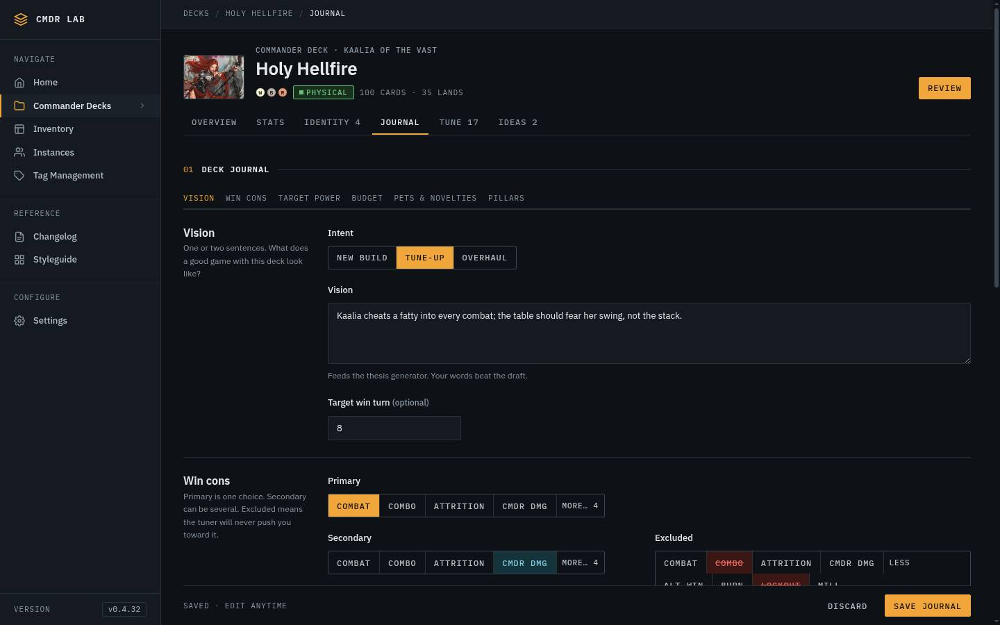
- **Deck page** (`/deck/Holy Hellfire`): header meta row (pips · status chip ·
  "100 cards · 35 lands"), then the hero (commander, stat strip, curve/types/colour/profile),
  then the Visual/List decklist. Cards are `hud-art--card` with name, CMC and pips
  in the caption; nothing ever sits on the art.
  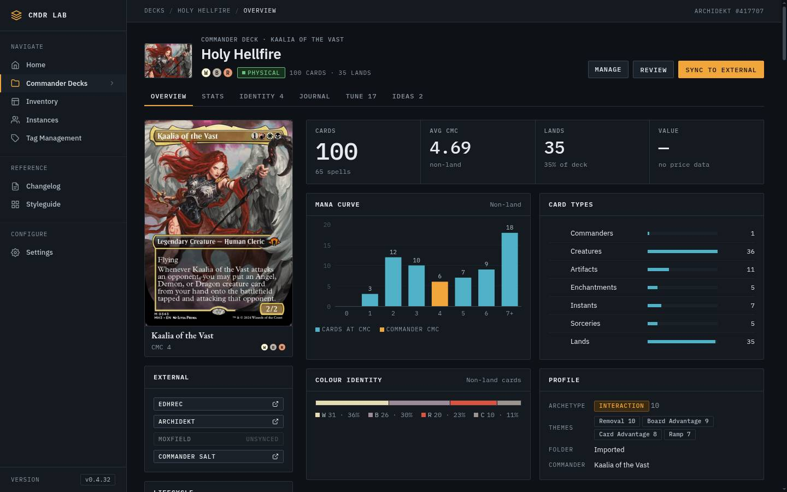
- **Real data that drives the mocks:** Holy Hellfire has **3 Game Changers**
  (Demonic Tutor, Necropotence, Teferi's Protection), 4 tutors by oracle text,
  journal target power **8**, computed power **6.5**, pets Dragon Tempest + Lyra
  Dawnbringer. So it's minimum Bracket 3 today: a perfect "bracket 1 or 2 with
  Game Changers" case. Across all 57 decks, 39 have at least one GC (top: Celes
  Upgrade with 10).
- **Phone (390):** the 56px icon rail stays, so content is ~300px wide. Every
  new block must survive that.

---

## 1. System (shared by all three directions)

### 1.1 Severity language: shape + colour, never colour alone

| Kind | Glyph | Colour token | Meaning | Copy pattern |
|---|---|---|---|---|
| Hard | ■ | `--br-hard` = `--danger` | A WotC hard rule is broken (GC count, MLD, extra-turn loops, early 2-card combos) | "**3 Game Changers.** Bracket 2 allows none. Cut 3 to fit, or raise the target." |
| Advisory | ▲ | `--br-adv` = `--signal` | Worth a look, never moves the bracket | "**Plays above target.** Estimated Bracket 3, target 2." |
| Clean | ● | `--br-ok` = `--ok` | Nothing to do | "No conflicts with Bracket 3" |

- Hard vs advisory comes from `conflict.severity` (BR-4). The UI never decides severity.
- The **target bracket chip is always neutral.** The target is a choice, not an
  error; severity travels as a separate count chip ("■ 3 conflicts"). (A first
  pass coloured the target chip red; it read as "your setting is wrong".)
- Brackets are an ordered scale, so where a ladder needs colour it uses the
  **data ramp** (`--data-1..5`), never mana colours (kit rule: mana = WUBRG only).

### 1.2 Estimates vs targets: one notation everywhere

Both estimates are always shown against their target, with the same delta format:

| | Value | vs target | Delta |
|---|---|---|---|
| Estimated bracket | `3` + name "Upgraded" | `target 2` | `▲ +1 above target` / `▼ −1 below target` / `● on target` |
| Estimated power | `6.5` `/10` | `target 4` | `▲ +2.5 · outside ±1.5` / `▼ −0.5 · within ±1.5` |

- Delta colour = **outside tolerance**, never sign: bracket is outside if ≠ target;
  power is outside if `|est − target| > 1.5` (the `power_aligned` threshold in
  `analytics/engine.py`; BR-4/BR-6 reuse that constant, the UI shows the number it gets).
- Exact-mismatch advisories ("Plays above target" / "Plays below target") and the
  power-mismatch advisory are **rows in the conflict list** like any other conflict,
  so they count in "N conflicts" and can be read in one place.

### 1.3 "How this was decided" (explanation panel)

A `hud-tray` (`
`), collapsed by default, labelled
**"How this was decided · N signals"**. Contents, in this order:
1. `explanation.summary`: the plain-language paragraph from BR-4, verbatim.
2. A table of `explanation.signals[]` in API order: **Signal · Value · Effect · Kind
   (Hard/Advisory) → bracket|power · Source.**
3. Footnote: "Hard signals set a floor (the lowest bracket the deck can be).
   Advisory signals never move the bracket. Evaluated 4 min ago · input a3f9c2".

At ≤640px the table becomes stacked rows (signal + value on one line, effect,
then kind + source); no sideways scroll. Verified: 0 elements past 390px.

### 1.4 Flagged cards in the decklist

- **Nothing on the card image** (kit rule: captions sit below art). A flagged card gets:
  - its frame in the severity colour plus a 4px severity bar across the top
    (`.br-flag::before`, so layout doesn't shift),
  - a caption line: `■ Game Changer · Over Bracket 2` (spelled out: "B2" next to the black-mana pip reads as colour) (`▲` for advisory-only). The caption
    has an off-screen prefix "Hard rule:" / "Advisory:" for screen readers.
- A card in a hard and an advisory conflict shows as hard (hard wins).
- Group headers get a count link: "Enchantments 5 · **1 flagged ↓**". It jumps to
  the first flagged card in that group, focuses it and pulses it (2 × 320ms scale
  1.035; under reduced motion, an outline instead).
- Card-name buttons in the conflict rows (`hud-cardlink`, serif like every card
  name in the kit) do the same jump.
- **List view:** the same caption text goes in the Card cell as a chip
  (`hud-chip--danger` / `--signal`). Not mocked; it's the same data in a table cell.

### 1.5 States (every direction implements all of them; pick from the mockup bar)

| State | Key | What shows |
|---|---|---|
| Hard conflicts | `b2` | Target 2, est 3: 1 hard (3 GCs) + 2 advisory (plays above, power +2.5) |
| Hard + pet card | `b1` | Target 1, power 3: as above + "Your pet card Necropotence is a Game Changer: your call" (advisory, card flagged `· pet`) |
| No conflicts | `b3` | Target 3, est 3, power 6.5 vs 7. Calm; notes "3 of 3, that's the cap" |
| Plays below | `b4` | Target 4, est 3: advisory only ("fine if you're sandbagging") |
| Unset | `unset` | No target: "This deck plays like Bracket 3" + link to set one; no flags |
| Not evaluated | `pending` | `GET /api/deck/{id}/bracket` says not evaluated: muted block + **Evaluate now** (POST) |
| Re-evaluating | `running` | Last stored result + "Re-evaluating…" data chip, `aria-busy` |

A failed eval falls back to the last stored result, plus a muted "Last check
failed · retry" line. It never blocks the page (per BR-5).

### 1.6 Tokens added (all in `brackets.css` `:root`, `--br-*`)

`--br-hard/-dim`, `--br-adv/-dim`, `--br-ok/-dim` (aliases of existing semantic
tokens), `--br-step-1..5` (data ramp), `--br-flag-w`, `--br-dim` (lens opacity),
`--br-track-h`, `--br-pulse`. If shipped they move into hud.css section 1, and the
classes become `hud-bracket-*`. No raw colours anywhere.

### 1.7 Motion

Kit durations only: `--dur-fast` hover, `--dur-base` lens dim, `--dur-slow` pulse
and the C track markers. Only `transform` and `opacity` animate. Everything has a
`prefers-reduced-motion` fallback (no pulse → outline; markers jump).

### 1.8 Data the UI reads (BR-5 stored result; names per BR-4 card)

`target_bracket | null`, `estimated_bracket`, `estimated_power_level`,
`target_power_level` (from journal), `aligned`, `no_target`,
`conflicts[{severity, rule, message, cards[]}]`,
`explanation{signals[{signal, value, effect, source}], summary}`, `evaluated_at`,
input hash. The mock adds a short `title` per conflict ("3 Game Changers"). If
BR-4 doesn't return one, BR-6 uses the first sentence of `message`. **Open
question for BR-6:** signals don't carry `kind` (hard/advisory) or `drives`
(bracket/power) in the BR-4 shape. Either add them, or drop the Kind column and
keep Effect.

---

## 2. Direction A · Inline (conservative), **recommended**

Kit pieces only. Every new element is a variant of something already on the page.

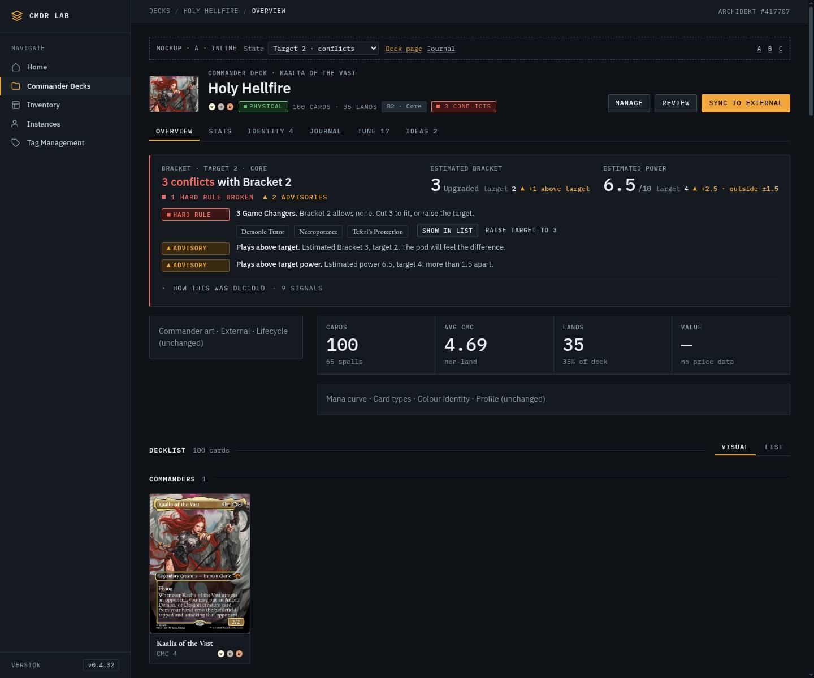

**Journal.** The section is renamed **"Power & bracket"** (anchor nav too). Under
the power scale:
- **Bracket · 2 · Core**: a `hud-seg--scale` with `Off 1 2 3 4 5`, the same 2.5rem
  cells as power and the same left edge. A data-coloured notch marks the estimate
  on both scales (power notch on the cell the estimate falls in).
- "Current estimate: Bracket 3 (computed)", mirroring power's hint line. The power
  hint gains "▲ 2.5 from target (over 1.5)" when outside tolerance.
- A **definition card** (25rem, the width of the power tier rail): name, the
  plain-language line, and the hard rules in primary text. It updates live as you
  arrow through the scale (`aria-live=polite`, `aria-describedby` on the group).
- If the target is below what the list is today: an advisory note, "This list is
  **Bracket 3 today**: its Game Changers aren't allowed in Core. Saving will flag
  it on the deck page." Saving is never blocked.

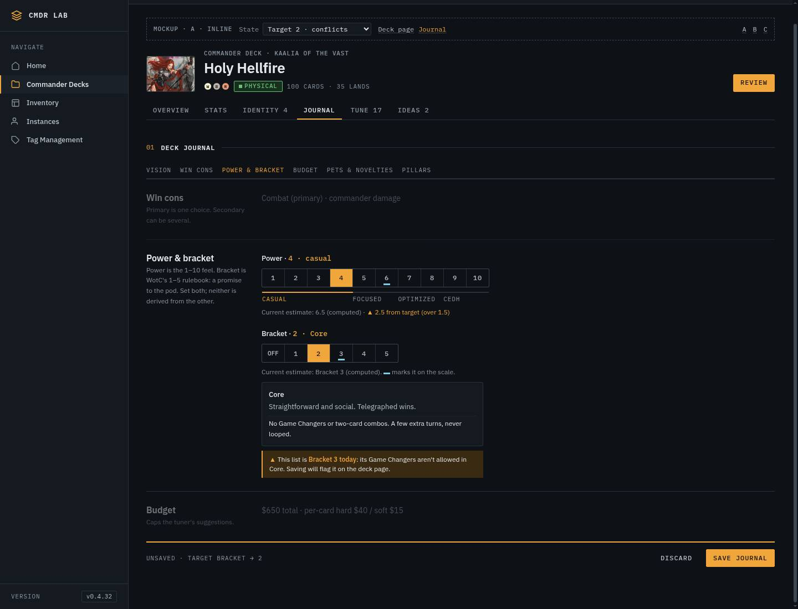

Plain-language lines (copy for BR-6; rules from `/api/brackets`):

| # | Name | Line | Rules |
|---|---|---|---|
| 1 | Exhibition | Theme over power. Show off something odd. | No Game Changers, two-card combos, extra turns or land denial. |
| 2 | Core | Straightforward and social. Telegraphed wins. | No Game Changers or two-card combos. A few extra turns, never looped. |
| 3 | Upgraded | Powered up. Strong synergy, can win in one big turn. | Up to 3 Game Changers. Two-card combos only late. No land denial. |
| 4 | Optimized | Lethal, fast, consistent. Not tuned for the cEDH meta. | Anything legal goes. |
| 5 | cEDH | Built for the cEDH metagame. Winning over expression. | Anything legal goes. We never compute 5; you declare it. |
| Off | Unset | No target, so no bracket checks. | The deck page still shows the estimate. |

**Deck page.**
- Header meta row: `B2 · Core` (neutral) + `■ 3 conflicts` (a button; jumps to
  and focuses the banner). Unset: `Est. B3 · Upgraded`. Clean: `● No conflicts`.
- **Banner** between the tabs and the hero, full width. Left: eyebrow "Bracket ·
  target 2 · Core", h2 "**3 conflicts** with Bracket 2", tally "■ 1 hard rule
  broken ▲ 2 advisories". Right: the two estimate blocks. Below: one row per
  conflict (severity chip · bold title · message · card buttons). The GC row adds
  **Show in list** and **Raise target to 3** (opens the Journal preselected). The
  explanation tray goes last.
- Left edge colour = worst severity (danger / signal / ok / neutral for unset/pending).
- Decklist: flags as in §1.4.

| 390 deck | 390 flags | 390 journal |
|---|---|---|
| 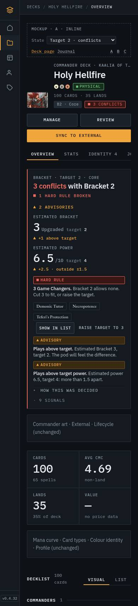 | 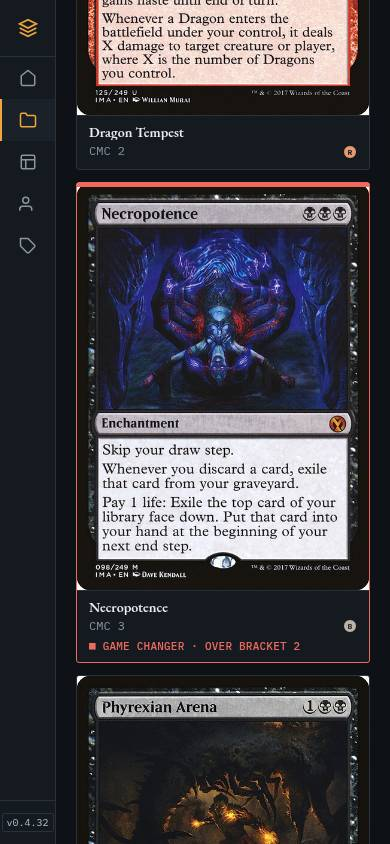 | 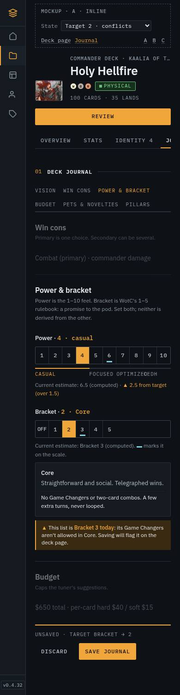 |

At 390 the banner is one column: estimates stack, conflict rows put the chip
above the text, and the tray table becomes stacked rows.

States: `a_state_{b1,b3,b4,unset,pending,running}_{1440,390}.jpg`, explanation
open: `a_why_open_{1440,390}.jpg`.

**Why A:** it answers every requirement on the page you already read, with
components BR-6 can build from the kit in one card. The banner is the single
source of truth. The header chip and card flags are pointers to it.

**Cost:** the banner adds ~260px above the hero when there are conflicts (~150px
when clean). Accepted: when there are conflicts, that *is* the most important
thing on the page.

---

## 3. Direction B · Ledger (middle)

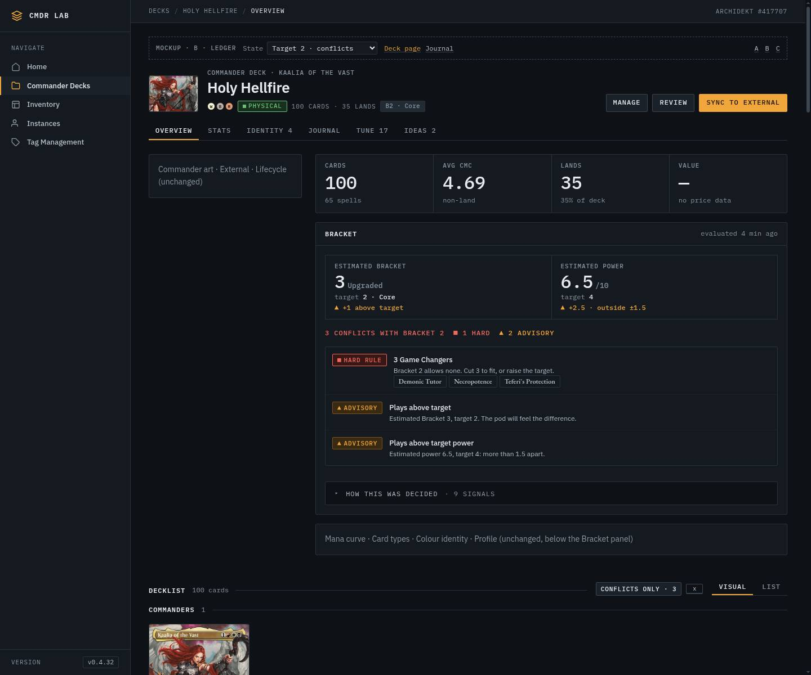

**Journal: the ladder.** Five rungs plus Off, each a radio row with number ·
name · line · rules. All five meanings are visible at once, which is the most
literal answer to "a short plain-language meaning of each bracket". Unselected
rungs below today's minimum get a quiet "needs cuts". The selected rung below the
minimum gets a ■ chip and an inline reason ("3 Game Changers (…). Core allows
none."). The estimate rung gets a data chip. ↑/↓ moves (native radios).

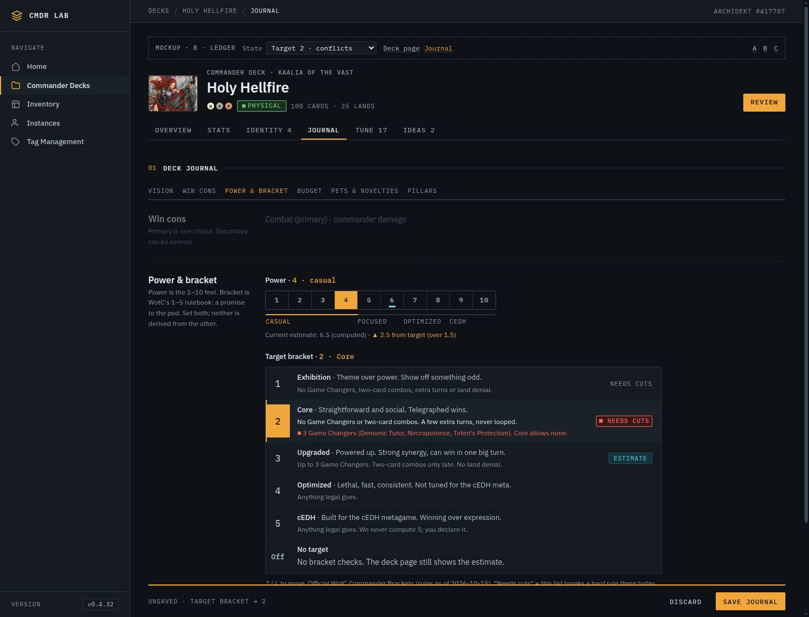

**Deck page: Bracket panel** in the hero column (between the stat strip and the
charts), not above it. It holds a 2-cell estimate grid, the tally, a ledger of
conflict rows and the explanation tray. The decklist gets a **Conflicts only · 3**
toggle (`x`), which filters the visual and list views to flagged cards.

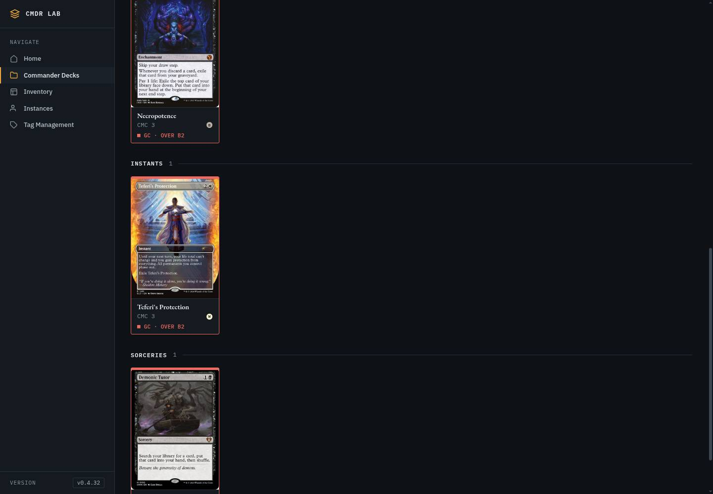

- **Pro:** the ladder teaches the system; the panel doesn't push the hero down;
  "Conflicts only" is the fastest way to see what to cut.
- **Con:** the ladder is ~330px tall in a form that's already long. The panel sits
  below the fold at 1440 when the commander column is tall. On phone it's after the
  stat strip, so conflicts aren't the first thing you see.

---

## 4. Direction C · Rule 0 (radical)

The bracket *is* the pre-game conversation, so the deck page leads with it.

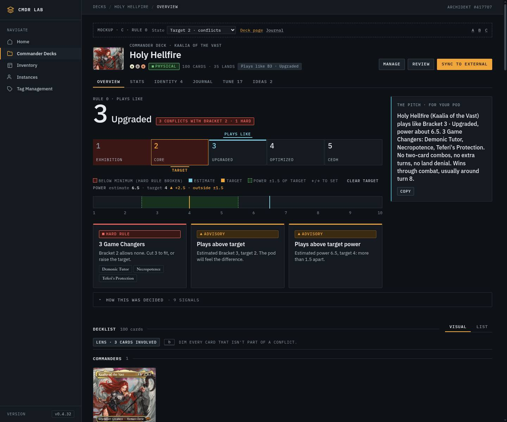

- **"Plays like 3 Upgraded"** in `--fs-display` mono, plus the verdict pill.
- **Bracket track:** five tiles. Tiles below the hard floor are tinted
  `--br-hard-dim`; the estimate tile gets a data top-bar and a **Plays like** marker
  above; the target gets a signal outline and a **Target** marker below. You can
  **set the target right on the deck page** (click/←/→). The marker slides
  (transform, 320ms) and it saves to the Journal. The Journal uses the same track.
- **Power rail:** 1-10, with the ±1.5 tolerance band around the target and pins for
  target and estimate.
- **Conflict tiles:** one per rule, staggered `hud-enter`.
- **The pitch:** a copyable paragraph for the group chat ("Holy Hellfire (Kaalia)
  plays like Bracket 3 · Upgraded, power about 6.5. 3 Game Changers: … Wins through
  combat, usually around turn 8."), assembled from the stored result + journal.
- **Lens** (`b`, Esc to leave): dims every uninvolved card to 28% and lifts flagged
  cards 3px.

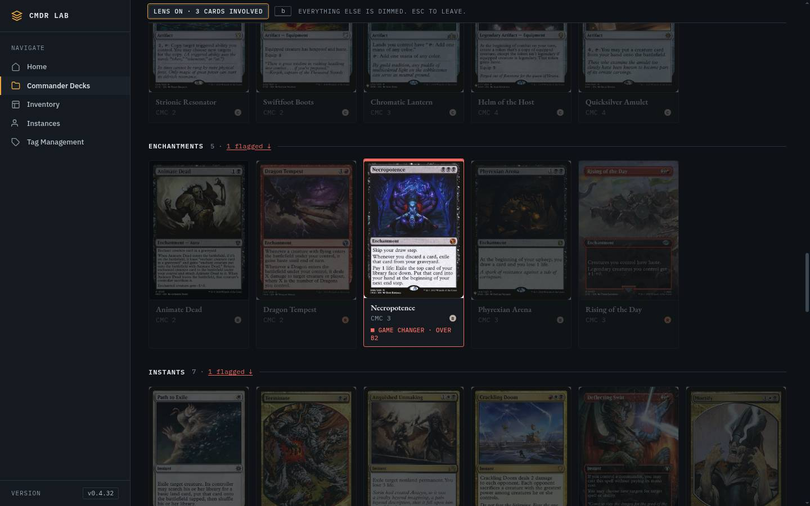

- **Pro:** the most expressive. The track makes "minimum vs target vs estimate"
  instantly legible. The pitch is a genuinely new, useful thing for real pods.
- **Con:** a new component family (track, rail, tiles) and a second place to edit a
  journal field (two write paths for one value). It uses `--fs-display`, which the
  kit reserves for the Lab thesis hero. It takes the most vertical space of the three.

---

## 5. Comparison

| | A · Inline | B · Ledger | C · Rule 0 |
|---|---|---|---|
| Journal control | seg + live definition | 5-rung ladder | track (same as deck page) |
| Meaning of each bracket | selected one, live | all five at once | name on tile, definition below |
| Where conflicts live | banner above hero | panel inside hero | board above hero |
| Card flags | frame + caption | frame + caption + Conflicts-only filter | frame + caption + Lens |
| New components | 0 (variants only) | ladder, panel grid | track, rail, tiles, pitch, lens |
| Edit target from deck page | no (link to Journal) | no | yes |
| 390px | ✓ no overflow | ✓ | ✓ |
| BR-6 effort | S | M | L |

Every direction was checked at 1440 and 390 in all 7 states, on both the deck
page and the Journal (84 renders). In every one, no element extends past the
viewport (horizontal tab strip excluded; it scrolls by design).

## 6. Recommendation

**Ship A.** It's the only one that BR-6 can build entirely from the HUD kit in one
card, and it puts conflicts where you'll see them, above the fold.

## 7. Phased path

1. **BR-6 = A.** Journal seg + definition + advisory note; deck header chips;
   banner with estimates, conflict rows, explanation tray; card flags (visual +
   list); all 7 states.
2. **A+1 (small follow-up):** B's **Conflicts only** decklist filter (`x`). It's
   one toggle and the best "what do I cut" tool. Pairs with BR-7 ("to reach
   bracket N, cut these").
3. **A+2:** a bracket badge on `/decks` cards (neutral `B3`, plus a ■/▲ count dot),
   so you can find conflicting decks without opening each one.
4. **Later, optional:** C's **pitch** as a "Copy Rule 0 summary" button in the
   banner (cheap, high value), and C's **lens** as an alternative to the filter.
   The full track/board only if A feels too quiet after living with it.

## 8. Deliberately not done

- No chip or overlay on card art (kit rule; and it covered the printed card name).
- No hatched/striped "below floor" tiles in C: solid tint instead (kit bans gradients).
- No red target chip: severity is a separate count.
- No blocking save when the target is below today's minimum: the user's bracket
  choice wins (BRACKETS_SPEC "intent first"); we warn and flag.
- No new evaluation rules, no app code.
- Not fixed here (existing app, flag for a UI-polish card): at 390 the live
  `hud-scale-tiers` labels under the power scale crowd ("OPTIMIZEDCEDH"), and
  the active deck tab can sit clipped in the horizontal tab strip.

## 9. What's real vs illustrative in the mocks

Real: bracket table + rules (`/api/brackets`, 2026-10-15), the 53 Game Changers,
Holy Hellfire's 100 cards, its 3 GCs, its 4 tutors, computed power 6.5, its pets.
Illustrative (marked `*` in the explanation table): Commander Salt 6.6,
Spellbook estimate, interaction count effect, two-card combo result, the
"evaluated 4 min ago" stamp. Target power is 4/3/7 in some states (the real one
is 8) so each story stays coherent. The `b1` state pretends Necropotence is a pet
card, to show the pet-card advisory.
