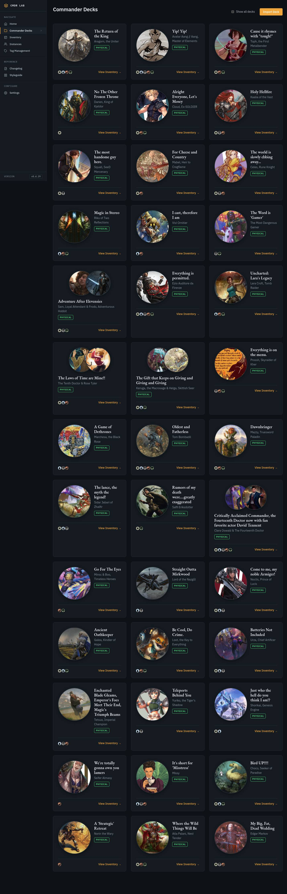
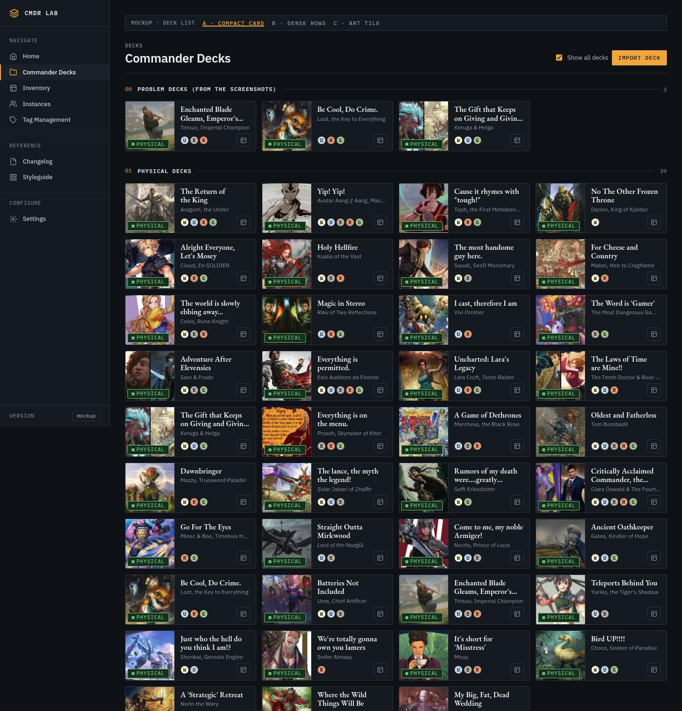
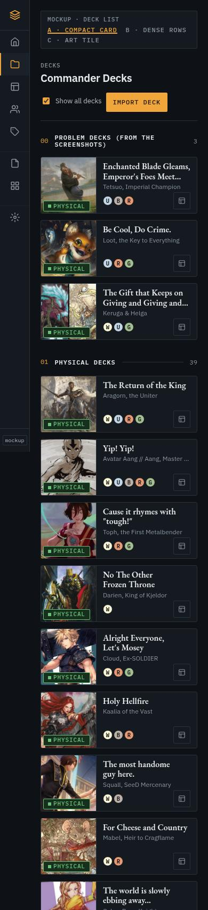
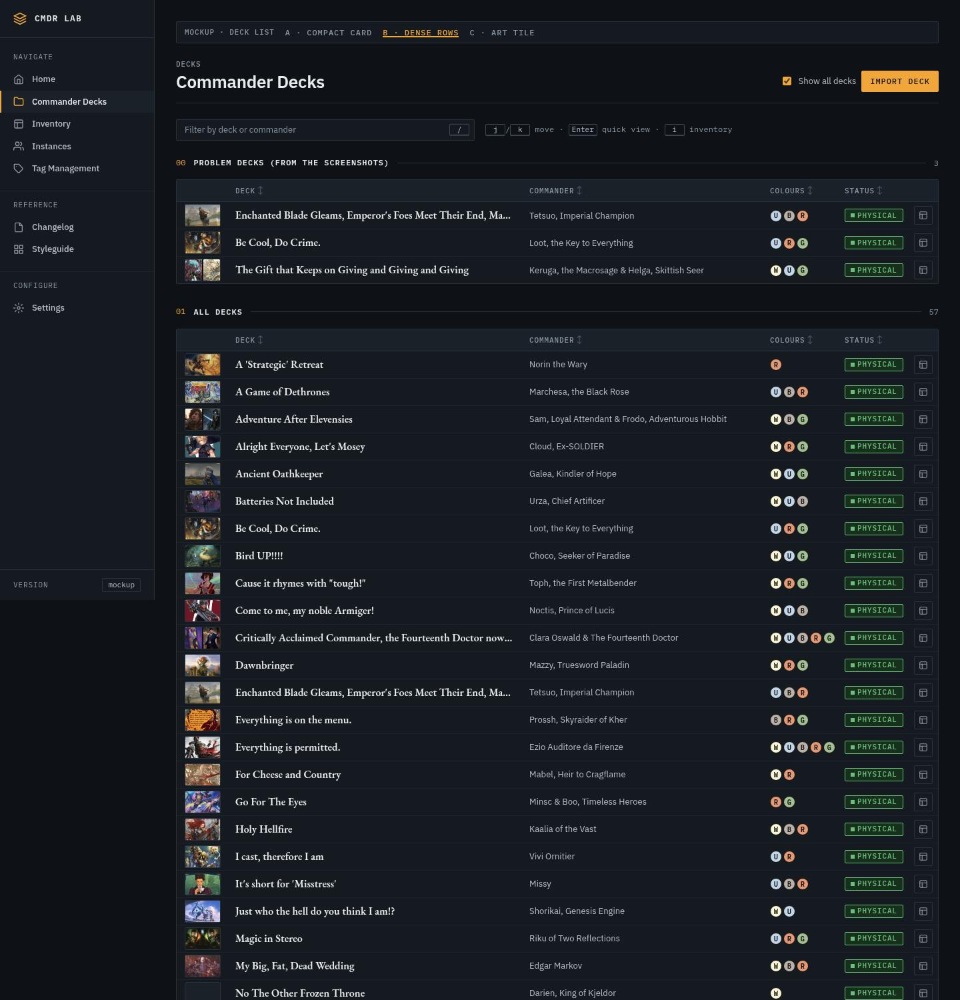
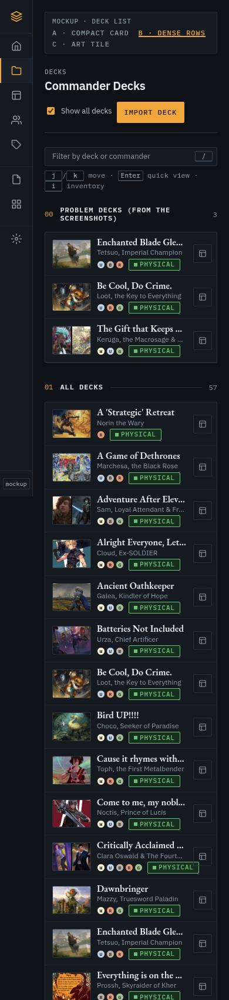
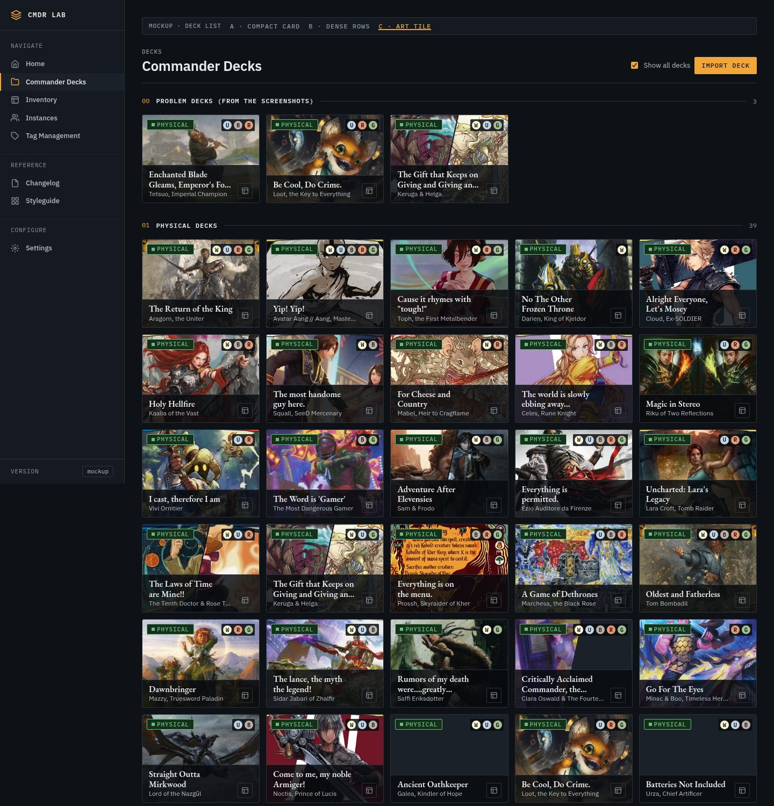
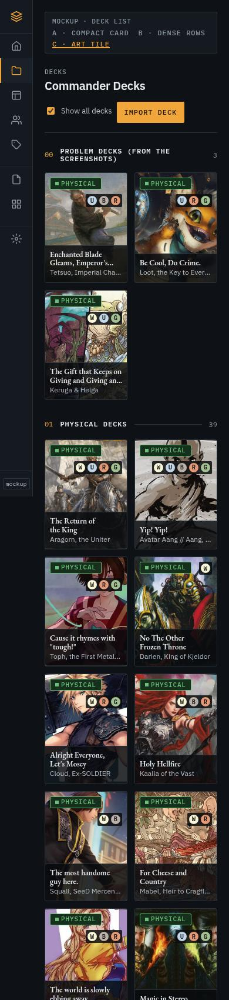

# Deck list cards: three options (/decks)

Status: design proposal, mockups only. No app code changed.
Mockups: `docs/design/deck-cards/` (open the HTML files straight from disk;
they load `static/css/hud.css` and `static/js/hud.js`). Data: `data.js` is a
snapshot of `GET /api/decks` from the live app (57 decks: 39 physical, 14 WIP,
4 virtual, 0 retired) taken 2026-10-14.

## What's wrong today (measured on the live app, v0.4.30)

| | 1440 × 900 | 390 × 844 |
|---|---|---|
| Columns | 3 | 1 |
| Card heights in use | 277 / 337 / 357 / 359 / 383px | 18 different heights, 277 to 480px |
| Decks fully on the first screen | 6 | 2 |
| Height of the 39 physical decks | 4215px | 13459px |

Causes:
- The 160px circular art takes half the card, so the title and commander get
  a column about 140px wide. Titles wrap to 3 to 9 lines.
- Nothing is clamped. Grid rows stretch to their tallest card, and the footer
  isn't pinned, so short cards leave a gap at the bottom.
- Partner decks switch to a different layout (two overlapping portraits
  stacked on top), so the grid has two card shapes.
- The card is a `div onclick`, so you can't Tab to it, and it opens the modal
  with no keyboard path. Art comes from the `api.scryfall.com` redirect, which
  DESIGN_TOKENS.md warns returns 429 on grids.

## Rules all three options follow

- **Fixed height per option.** Every card in an option is the same height,
  whatever the title length or commander count. Measured: 1 height per option
  at both widths, across all 60 rendered items (57 decks plus the 3 problem
  decks pinned at the top).
- **Title: 2 lines max.** It's clamped with an ellipsis (B uses 1 line), and
  the full name plus all commanders are in the `title` attribute. The title
  stays a real link to `/deck/<name>`.
- **One art frame for 1 or 2 commanders.** Partners split the same frame,
  with a 2px gutter in the page colour. There are no overlapping circles and
  no second layout. This closes the partner-portrait issue for `decks.html`
  only; `deck_head` and `deck_stats` are untouched.
- **Kit only.** Status uses `HUD.statusChip` (Physical = ok, Virtual = data,
  WIP = signal, Retired = neutral). Colours use `HUD.pips` (18px). Art uses
  `HUD.scryfall(uid, 'art_crop')` with the CDN plus `data-fallback`. Spacing,
  colour, type and motion are all HUD tokens. Option-specific sizes live in a
  `--dc-*` block at the top of `deck-cards.css`.
- **Inventory** is an icon button that uses the sidebar's Inventory glyph,
  with an `aria-label` and a tooltip. It's 28px, or 32px at 900px and below.
- **Quick-view modal.** A stretched `<button>` covers each card, sitting
  under the real links, so a click anywhere on the card opens the existing
  modal (unchanged; the mockup shows a stand-in). Tab reaches it, and so do
  `j`/`k`. Enter opens the modal, Esc closes it, and focus returns to the
  card. `i` opens inventory for the focused deck.
- **Motion.** A `hud-enter` rise is staggered 40ms per item and capped at 15
  items. Art scales 4% on hover, and the card presses to 98.5%. Only
  transform and opacity animate. Everything is off under
  `prefers-reduced-motion`.

Checked in the browser for each option at 1440 and 390:
- No chip, pip or icon overflows its card.
- No title runs past 2 lines.
- There's no horizontal scroll.
- j/k, Enter, Esc and focus return all work.
- Clicking inventory doesn't open the modal.
- In B, the `/` filter and column sort work.

## A · Compact card (conservative)

`docs/design/deck-cards/a-compact.html`

This is today's card with the fat removed. A 104px card: a square art frame
flush left with the status chip on the art (the `.hud-art-media .hud-chip`
pattern), then the title (2 lines), the commander (1 line), and a pips +
inventory row.

| | 1440 | 390 |
|---|---|---|
| Columns / card height | 4 / 106px | 1 / 106px |
| Decks on the first screen | 19 (was 6) | 4 (was 2) |
| 39 physical decks | 1203px (−71%) | 4625px (−66%) |

- Pro: smallest change from what you know. Easy to scan. Art is still
  recognisable. It's a template string plus about 30 lines of CSS.
- Con: one-line titles leave a little air above the meta row. That's by
  design, because a fixed height beats ragged rows. The commander line
  ellipsizes long names ("Toph, the First Metalben…"); the full name is in
  the tooltip and the modal.

## B · Dense rows (power-user)

`docs/design/deck-cards/b-rows.html`

One `hud-table` for every status, with 40px rows: thumb · deck · commander ·
colours · status · inventory. You get sortable columns (the kit's
`data-hud-sortable`), a `/` filter by deck or commander, and j/k/Enter/i.
On phone, each row becomes a two-line list item with pips and status under
the name.

| | 1440 | 390 |
|---|---|---|
| Row height | 41px | 74px |
| Decks on the first screen | 12 | 5 |
| 39 physical decks | 1668px | 2906px (−78%) |

- Pro: the densest view, and the only one where Status is a real column you
  can sort, so one list replaces the four groups. It's the fastest to search
  and the most keyboard-friendly.
- Con: art shrinks to a 52px thumb, so the list stops feeling like your
  decks. The title gets 1 line, though at 1440 the column fits even Tetsuo's
  title up to "…Ma…". It's the most new behaviour to build (filter, sort,
  flat list).

## C · Art tile (radical)

`docs/design/deck-cards/c-tiles.html`

The commander art is the card: a 4:3 tile with status and pips pinned at the
top. The bottom carries a solid `--scrim` plate (not a gradient) with the
title (2 lines), the commander and inventory. Partners share the frame,
split on a diagonal with a 2px seam.

| | 1440 | 390 |
|---|---|---|
| Columns / tile height | 5 / 165px | 2 / 187px |
| Decks on the first screen | 13 | 3 |
| 39 physical decks | 1426px | 3876px |

- Pro: the most striking, with the most columns at 1440. Art is the fastest
  way to find a deck by sight.
- Con: it breaks a written kit rule. DESIGN_TOKENS.md says the
  `.hud-art` caption "sits below the art, never on it". The plate also
  covers the lower 40% of the art, and centre crops sometimes put a face
  under it. Titles are smaller (14px on phone), and inventory moves into the
  quick view on phone.

## Recommendation: ship A, then add B as a list toggle

**A** fixes all three screenshot problems with the least new surface. It
triples what fits on a screen, works on phone, and stays inside the kit's
rules. B is the better tool for "find deck X fast", but it's a different
page, not a card fix. Ship it as a view toggle once A is in. Skip C:
it's the flashiest, but it fights the kit's caption rule and hides art under
the plate. I wouldn't spend that rule on a list page.

### Phased path

1. **A-1 (S).** Replace the `.deck-card` template string in
   `templates/decks.html` (about line 1070) and its page CSS with option A:
   - Build it with `HUD.scryfall`, `HUD.pips` and `HUD.statusChip`.
   - Delete the 160px `.commander-icon` and `.deck-header--multi` rules, and
     `createColorPips` if nothing else uses it.
   - Move the `--dc-a-*` sizes into `hud.css` tokens.
2. **A-2 (S).** Make the card keyboard-reachable: a stretched button that
   opens the modal, j/k/Enter/i, and focus return on modal close. This only
   touches how the modal opens; the modal itself is unchanged.
3. **A-3 (XS, optional).** Hide the status chip when every card in a section
   has the same status (inside "Physical decks", for example), and show it
   only in mixed views.
4. **B (M).** Add a Cards | List toggle saved in `localStorage`. The list is
   option B's flat table with `/` filter, sorting and the status column.
5. **Later.** If partner frames on `deck_head` and `deck_stats` should match,
   that's the open partner-portrait issue, not this change.

### Chosen against

- Circular art: a circle wastes the corners of a 626×457 art crop, and the
  kit's frames are 3px-radius rectangles.
- Gradient scrims (C): the tokens rule out gradients, so the plate is solid
  `--scrim`.
- Wrapping commander lines: they would bring back variable height. The
  tooltip and modal carry the full names.
- Parallax or tilt on tiles: it costs performance and doesn't explain
  anything.

### Seen, not fixed (outside this card)

- Prossh ("Everything is on the menu.") shows rules text in its art crop.
  The stored `commander_uid` likely points at a printing with a bad crop.
  This is a data issue.
- The live phone header wraps "Show all decks" to 3 lines and clips the
  Import button at 390. All the mockups use `hud-page-head`, which wraps
  cleanly.

## Files

- `docs/design/deck-cards/a-compact.html`, `b-rows.html`, `c-tiles.html`:
  one page per option, with a switcher at the top. "Problem decks" (Tetsuo,
  Loot, Keruga + Helga) are pinned first.
- `docs/design/deck-cards/deck-cards.css` / `deck-cards.js`: the shared
  harness (shell, groups, quick view, keys).
- `docs/design/deck-cards/data.js`: the live data snapshot.
- `docs/screenshots/deck-cards/`: `before/` (live app) plus `{a,b,c}_{1440,390}.jpg`
  and `a_quickview_1440.jpg`.
