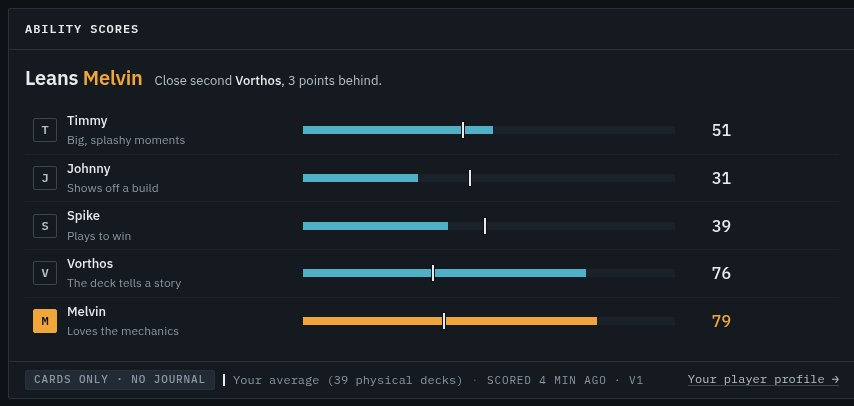
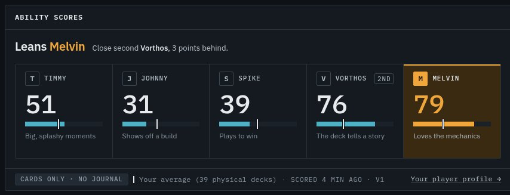
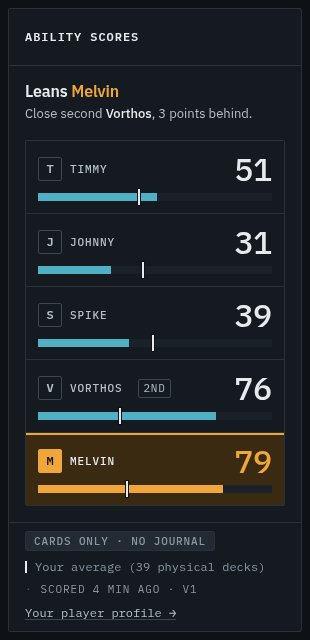
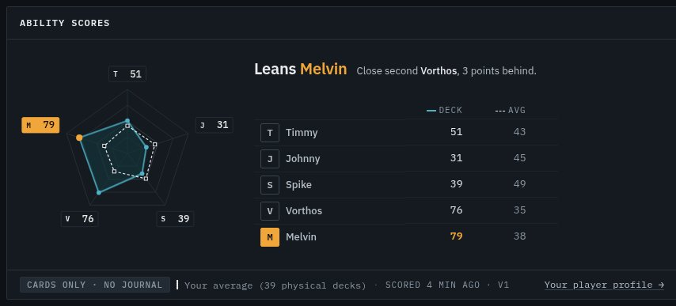
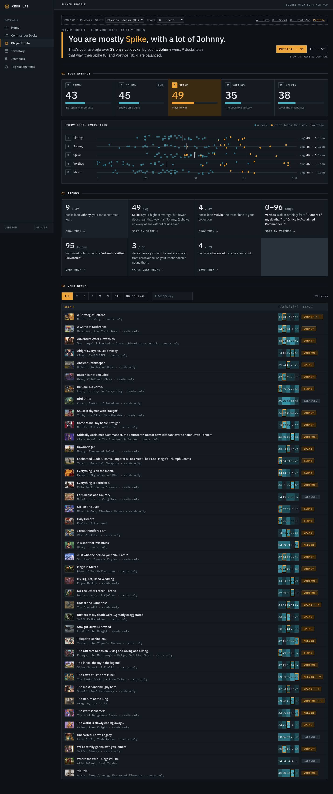

# Ability scores UX spec (PS-D): deck page panel + `/profile` player review

Status: design proposal. Mockups and docs only; no app code changed.
**Reference only. Do not merge this branch to main** (repo convention for designer docs).
Builds on: `docs/PERSONALITY_SPEC.md` (PS-1, the scores and the `leans_toward` rule).
Consumed by: PS-4 (`t_4a3e05d3`). Reads the PS-3 APIs (`t_b8871254`): `GET /api/decks/{id}/personality`, `GET /api/profile/personality`.

Mockups: `docs/design/personality/`. They open straight from disk and load the real
`static/css/hud.css` + `static/js/hud.js`. Each page has a dashed **mockup bar** (not product UI) with a
State picker and A / B / C / Profile links. Deep links: `b-sheet.html#s=kaalia&open=timmy`, `profile.html#p=low`.

| File | What |
|---|---|
| `a-bars.html` | **A · Stat bars** (conservative) |
| `b-sheet.html` | **B · Character sheet** (middle), **recommended** |
| `c-pentagon.html` | **C · Pentagon** (radical) |
| `profile.html` | `/profile` page; `Chart` picker switches the average between B and C |
| `ps.js` / `ps.css` | shared shell, renderers, states, `--ps-*` tokens |
| `fixtures.js` | **real** scores for all 55 decks + full evidence for 6 (see §9) |

Screenshots: `docs/screenshots/personality/` (44 files, every state at 1440 and 390).

---

## 0. Decisions (the short version)

1. **Deck page: B · Character sheet.** Five tiles in one hairline strip, like the stat strip already
   on the page and like a D&D stat block. Big mono number per axis, a meter with your average as a
   tick, and the lean tile solid signal (the Identity hero-pillar treatment). One click (or `T J S V M`)
   opens the evidence under the strip.
2. **It goes in the hero's main column, straight under the stat strip** (above Mana curve). It's
   the most "this is the deck's personality" thing on Overview, and the main column had dead height
   below the Profile panel anyway.
3. **No per-axis colours.** Five axes do not get five hues: mana colours are WUBRG only, and
   "Timmy = red" would read as red mana. Axes are told apart by **position, name and a monogram**
   (T J S V M). Colour has exactly two meanings: `--data` = a score, `--signal` = the lean.
4. **Proportionate emphasis.** A clear lean (no `runner_up`) gets the solid signal tile. A close lean
   (`runner_up` set, ≤ 5 points) gets a **dim** signal tile + a neutral `2nd` tag on the runner-up,
   so 79 vs 76 never looks like a landslide. `balanced` gets no lean colour at all.
5. **`/profile` reads like a review doc**, not a dashboard: thesis headline ("You are mostly
   Spike, with a lot of Johnny."), a one-paragraph why, your average (same B tiles), a
   strip plot of every deck on every axis, rule-based trend callouts, then a sortable deck table
   with heat cells. Below 3 decks it says "Early read" and locks trends.
6. **Scope: physical decks by default**, with a `Physical · 39 / All · 57` toggle. Testing and
   digital lists are drafts; counting them skews you toward whatever you're tinkering with.

Recommendation in one line: **ship B on the deck page and on `/profile`; keep C's mini pentagon
"sigil" as an optional table column later** (it's the one thing the radar does better: shape at a glance).

---

## 1. What I looked at first (live app v0.4.34, Doctor / Rose deck)

- **Deck page** (`/deck/The Laws of Time are Mine!!`): hud-deckhead, then the hero grid (commander
  art + External + Lifecycle on the left; stat strip, Mana curve + Card types, Colour identity +
  Profile on the right). The right column ends ~400px before the left one at 1440, so a new panel there
  costs no scroll. Before: `psd_deck_1440.jpg` style; mock: `b_doctor_page_1440.jpg`.
- **Stats** (`/stats`): six-tile `hud-stat-strip`, numbered section heads, engine list + graph +
  inspector. The ability tiles borrow the stat strip's hairline-joined grid and the inspector's "click
  a thing, the detail opens beside/below it" pattern.
- **Identity** hero pillar: the only solid-signal tile in the app. That's the lean-tile precedent.
- **Phone (390)**: 56px icon rail stays, content is ~294px wide. Everything below was measured there.
- **Real numbers that drive the mock** (PS-1 hand calculator over live snapshots, 55 decks): Doctor/Rose
  51 / 31 / 39 / 76 / 79, leans melvin, runner-up vorthos. Physical average **43 / 45 / 49 / 35 / 38**
  (39 decks); leans johnny 9, spike 8, vorthos 8, timmy 6, melvin 4, balanced 4. Only **3 of 39**
  physical decks have a journal.

---

## 2. System (shared by all three directions + profile)

### 2.1 Tokens (all in `ps.css :root`; move to `hud.css` section 1 if this ships)

| Token | Value | Use |
|---|---|---|
| `--ps-axis` / `-dim` | `--data` / `--data-dim` | every meter, polygon, dot |
| `--ps-lean` / `-dim` | `--signal` / `--signal-dim` | the `leans_toward` axis only |
| `--ps-ref` | `--text-1` | "your average" tick / dashed outline |
| `--ps-journal` / `-neg` | `--ok` / `--danger` | journal nudge + / − |
| `--ps-meter-h` | 0.5rem | score track |
| `--ps-score` / `-sm` | `--fs-hero` (44) / `--fs-stat` (32) | tile number desktop / phone |
| `--ps-mono` | 1.375rem | monogram badge |
| `--ps-radar` | 17rem | C plot size |
| `--ps-sigil` | 1.5rem | mini pentagon in table rows |
| `--ps-dot` / `--ps-strip-h` | 7px / 1.75rem | profile strip plot |
| `--ps-grow` | `--dur-slow` (320ms) | meter / polygon grow |
| `--ps-lean-delay` | `5 × --stagger + --dur-slow` | lean lights up after the 5th meter lands |

No new raw colours. Everything resolves to existing kit tokens.

### 2.2 Colour meaning (fixed, don't improvise)

| Thing | Colour | Never |
|---|---|---|
| A score (meter fill, polygon, heat cell, dot) | `--data` ramp | a per-axis hue |
| The lean (tile, vertex, dot, table cell ring, headline word) | `--signal` | on the runner-up, on a callout, on "your average" |
| Runner-up | neutral `2nd` tag (`--line-strong` border, `--text-2`) | signal |
| Your average | `--text-1` tick / dashed line | data or signal |
| Journal nudge | `--ok` (+) / `--danger` (−); `--text-3` for ±0 | used for anything else |
| Degraded input note | `hud-chip--signal` with ▲ (advisory) | on the scores themselves |

### 2.3 Copy

- Axis line (under each name, from PS-1's table): Timmy "Big, splashy moments" · Johnny "Shows off a
  build" · Spike "Plays to win" · Vorthos "The deck tells a story" · Melvin "Loves the mechanics".
- Lean headline (the panel's one sentence), from `leans_toward` / `runner_up` / the §8 rule:

| Case | Headline | Why line |
|---|---|---|
| clear (`runner_up = null`) | Leans **Timmy** | "Big, splashy moments. 18 points clear of Spike." |
| close (`runner_up` set) | Leans **Melvin** | "Close second **Vorthos**, 3 points behind." |
| balanced, bunched (top − third < 8) | Balanced | "**Johnny, Spike and Vorthos** are within 7 points." |
| balanced, low (top < 35) | Nothing stands out | "Top score is **Johnny 34**, below 35 on every axis." |

The UI derives "bunched" vs "low" from the five scores using the PS-1 §8 thresholds; it never
re-decides `leans_toward`. If PS-3 returns a reason field, use that instead.

- Evidence value strings: the `FMT` table in `ps.js` (one formatter per signal, e.g. T1 → "5
  creatures at mv 6+", S5 → "avg mv 3.29 · lower scores higher"). Inverted signals (T5, S5) always say so.
- Journal `fields` are machine strings in the model (`preferred_win_conditions.primary=combat`). The UI
  maps them through `FIELD_COPY` → "Primary win con: combat", "Words in your notes: “fatty”, “swarm”".

### 2.4 Motion vocabulary (that's all of it)

| Motion | Where | Spec |
|---|---|---|
| grow | meters, evidence bars | `scaleX(0→1)`, `--ps-grow`, `--ease`, stagger `--i × --stagger` (T J S V M order) |
| light | the lean tile / headline word | opacity 0→1 after `--ps-lean-delay`: cause first, verdict second |
| pop | C polygon | `scale(.2→1)` + fade, `--ps-grow` |
| rise | evidence drawer, trend callouts | `translateY(6px)→0` + fade, `--dur-slow`, staggered |
| press | tile `:active` | `scale(.985)`, `--dur-fast` |

Only `transform` and `opacity`. `prefers-reduced-motion: reduce` turns all of it off (static final
state, no transitions). Checked in `ps.css` bottom block.

### 2.5 Evidence drawer (all directions)

One `region` below the chart (`#psEv`), opened by a tile / bar row / radar label. One axis at a
time; clicking the open axis again closes it.

- Head: `Melvin · 79` + axis line + sum `cards 78.6 ≈ 79` (journal: `cards 64.6 + journal 8.0 ≈ 73`) +
  `Esc` button. **The sum adds the rounded row values**, so a reader adding the column gets the same
  number (the model's `card_score` is unrounded and was 0.1 off).
- One row per `AxisEvidence`, in signal order, **zeros included** (dimmed, `is-zero`): code · label +
  value string · bar (`sub_score`) · `points / weight` · card chips.
- Cards: first 6 as `hud-cardlink` (opens the card modal like everywhere else), then `+N more` (ghost chip,
  expands in place). M3 loops show engine signatures as ghost chips.
- Journal rows: diverging bar from centre (± 10 scale), `+4.0 / ±10`. No journal: one row "No journal ·
  Cards-only score. A journal can nudge each axis by up to ±10."
- Foot: "Points = weight × how far the signal got along its band. Every signal is listed, including zeros."

`weight` is not in the PS-1 `AxisEvidence` model. **PS-3/PS-4: add `weight: int`** (or the UI derives it
as `points / sub_score`, which fails at 0). Flagged in §8.

### 2.6 Keyboard

| Key | Deck page | `/profile` |
|---|---|---|
| `T J S V M` | focus that axis + open its evidence | filter the deck table to decks leaning that way |
| `B` | | filter to balanced |
| `0` | | clear the lean filter |
| `/` | | focus the deck filter |
| `Esc` | close evidence, focus returns to its trigger | clear + blur the filter |
| `← → ↑ ↓` | move between tiles / radar labels | |

Never while typing (same guard as `deck_analytics.js`). Deck tabs keep `1–6`. Hints show in the panel
meta on hover devices only (`@media (hover: none), (max-width: 640px)` hides them).

### 2.7 Accessibility

- Tiles / rows / radar labels are real buttons (`aria-expanded`, `aria-controls="psEv"`), labelled
  "Melvin 79, lean" / "Vorthos 76, close second".
- Chart has a screen-reader sentence: "Timmy 51, Johnny 31, Spike 39, Vorthos 76, Melvin 79. Leans Melvin."
  The C radar is `role="img"` with the same label.
- Lean is never colour-only: the headline names it, the tile has the solid fill **and** an inverted
  monogram, the table chip says the name.
- Contrast (measured, `contrast.py` over the kit hexes): text-1 on signal-dim 11.5:1, on-signal on
  signal 9.1:1, ok on surface-1 7.8:1, danger 5.7:1. Heat cells: text-1 on data-0..3 (≥ 4.9:1),
  surface-0 on data-4/5 (5.0 / 7.5:1). The `±0` nudge was text-4 (2.5:1, fail) and is now text-3 (5.8:1).
- Focus: kit `--focus-ring` everywhere, inset on tiles so the hairline grid doesn't clip it.

---

## 3. Deck page: three directions

Panel: `hud-panel` "Ability scores", in `.deck-hero-main` right after `#deckStats`. Foot: notes chips ·
average key · "Scored 4 min ago · v1" · "Your player profile →".

### 3.1 A · Stat bars (conservative)



Five `hud-rank`-shaped rows: monogram · name + axis line · meter with average tick · value · nudge.
Lean row: signal fill + signal value. Phone: the axis line drops, the nudge moves under the name.

- ✓ Zero new shapes; it's the Card types panel with different data.
- ✓ Densest; easiest to compare five numbers.
- ✗ Reads as "another bar chart" on a page that already has three. No personality for a personality feature.
- ✗ Lean is a recoloured bar, so a close lean and a clear lean look the same.

### 3.2 B · Character sheet (middle) **recommended**




Five tiles in a hairline-joined strip (same grid as `hud-stat-strip`). Each: monogram + NAME + nudge ·
**44px mono score** · meter with average tick · axis line.

- Clear lean: solid `--signal` tile, on-signal ink, inverted monogram (`b_celes_clear_1440.jpg`).
- Close lean: `--signal-dim` tile + signal top bar + signal number; runner-up gets a neutral `2nd`
  tag (`b_doctor_1440.jpg`).
- Balanced: no signal anywhere; the headline says why (`b_bird_balanced_1440.jpg`, `b_wild_low_1440.jpg`).
- Open tile: `aria-expanded` + a caret notch into the drawer below (desktop); inset left bar (phone).
- Phone: tiles restack into rows `[mono NAME nudge 2nd] [32px score]` / `[meter]`; axis line hidden.

Why B: it's the RPG-stat-block the card asked for, it's built from two existing kit shapes (stat strip +
hero pillar), the big number is the hero (house style), and it degrades to a clean list on phone.

### 3.3 C · Pentagon (radical)



Radar: rings at 25/50/75/100, deck polygon in `--data` (fill 70%), **your average drawn on top**
as a dashed `--text-1` outline with square markers, lean vertex in signal. Labels are boxed buttons
(monogram + score) on a constant offset along each spoke. Side: lean headline + Deck / Avg table.

- ✓ Shape at a glance; "spiky" vs "round" decks are instantly different.
- ✓ The average comparison is the most visible of the three.
- ✗ Radars distort: area grows with the square of the score and adjacency implies a relationship
  between neighbouring axes (Timmy next to Johnny) that the model doesn't have.
- ✗ Needs the side table to be readable, so it's two charts in one panel. On phone it's 18rem tall
  before any numbers.
- Keep: the 24px **sigil** (labels off) as a deck-table column on `/profile` (`profile_pentagon_1440.jpg`).

### 3.4 Comparison

| | A Bars | B Sheet | C Pentagon |
|---|---|---|---|
| Fits HUD kit | existing shapes | stat strip + hero pillar | new SVG |
| Compare 5 numbers | best | good | needs table |
| "Personality" feel | low | high | highest |
| Close vs clear lean | no | yes | partial |
| Phone (390), panel body | 5 rows, 315px | 5 rows, 457px | radar + table, 554px |
| Build cost (PS-4) | S | S–M | M |

---

## 4. Deck page states (B shown; A and C implement the same)

| State | Trigger | Shows | Shot |
|---|---|---|---|
| Normal, close lean | `runner_up` set | dim lean tile + `2nd` | `b_doctor_*` |
| Normal, clear lean | `runner_up` null | solid lean tile | `b_celes_clear_*` |
| Balanced (bunched) | `leans_toward = balanced`, top ≥ 35 | no signal, "Balanced" | `b_bird_balanced_*` |
| Nothing stands out | `balanced`, top < 35 | no signal, "Nothing stands out" | `b_wild_low_*` |
| Journal used | `journal_used` | `+8` / `−2` / `±0` per tile; drawer journal rows | `b_kaalia_journal_*` |
| No journal | `journal_used = false` | foot chip "Cards only · no journal"; no tile nudges | `b_doctor_*` |
| Degraded input | any `notes[]` other than no-journal | foot chip ▲ "39 cards without metadata · low confidence" (one per note); scores still shown | `b_dragons_lowmeta_*` |
| Loading | first paint | hatched meters, numbers hidden, `aria-busy` | `b_state_loading_*` |
| Not scored yet | 404 / no stored result | dashed `ps-state`: "Not scored yet" + **Score now** | `b_state_pending_*` |
| Failed | 5xx / network | `ps-state.is-error` `role=alert`: "Couldn't load ability scores", the status line, **Retry**. Rest of the page unaffected | `b_state_error_*` |

Degraded-input notes map 1:1 to PS-1 §7 note texts. The UI never hides or re-weights a score because
of a note; it labels it.

---

## 5. `/profile`: player review

Nav: new sidebar item **Player Profile** after Commander Decks (pentagon icon, not the person icon:
Instances already uses that). Active by path prefix `/profile`. No deck tabs, just a crumb.



### 5.1 Layout (top → bottom)

1. **Head** (`ps-prof-head`): eyebrow "Player profile · from your decks' ability scores", `hud-thesis`
   blockquote headline, one-paragraph why, and on the right the scope toggle `Physical · 39 / All · 57` +
   "3 of 39 have a journal" (+ "N not scored" / "N failed" when relevant).
2. **01 Your average**: the same B tiles (static, no drawer) with the averaged scores. Lean styling
   follows the headline: clear → solid, close → dim + `2nd`, even → none.
3. **Every deck, every axis** (panel): strip plot, one row per axis, one dot per deck at its score.
   Dots of decks that lean that way are signal; average is a `--text-1` tick. Deterministic vertical
   jitter so stacks stay countable. Hover a dot: tooltip "Deck: Spike 90" and every dot of that deck
   lights up across all five rows. Click: scroll to + flash the deck's table row.
4. **02 Trends**: callout grid (`auto-fit`, 17rem min). Each: big mono number (+ `/ 39` or unit),
   one sentence that continues it, one ghost action that **acts on the table below** (filter / sort /
   open deck). The first is the lead (surface-2 + `--text-1` indicator: neutral on purpose; signal is
   the lean).
5. **03 Your decks**: lean filter seg (All T J S V M Bal "No journal") + name filter + count;
   sortable `hud-table`: deck (art crop, name, commander · "cards only" · ▲ low-metadata) ·
   T J S V M heat cells (`--data-0..5`, lean cell ringed in signal) · Leans chip ("Melvin · V" for a
   runner-up). Rows link to `/deck/{name}`. Phone: becomes a card list (name + chip / five cells).

### 5.2 Headline and callouts (rules PS-3 owns; the mock uses placeholders)

The headline comes from `PlayerProfile` (PS-3). The mock's placeholder rule, to show the three shapes:

| Shape | Placeholder rule | Copy |
|---|---|---|
| clear | top − 2nd ≥ 5 | "You are mostly **Spike**." |
| close | top − 2nd < 5 | "You are mostly **Spike**, with a lot of Johnny." |
| even | top − 3rd < 3 | "You play **a bit of everything**." |

The why line always reconciles **average vs count** in one breath, because they disagree on real data
(Spike has the highest average, but more decks lean Johnny): "That's your average over 39 physical decks.
By count, Johnny wins: 9 decks lean that way, then Spike (8) and Vorthos (8). 4 are balanced."
Ties say so ("All" scope: "By count, Johnny and Spike tie: 13 decks lean each way, then Timmy (11).").

Callout kinds the layout supports (each one sentence, number first):

| Kind | Example (real data) | Action |
|---|---|---|
| most common lean | **9** / 39 decks lean Johnny, your most common lean. | Show them → (filter J) |
| average ≠ count | **49** avg: Spike is your highest average, but fewer decks lean that way than Johnny. | Sort by Spike → |
| rarest / none | **4** / 39 decks lean Melvin, the rarest lean in your collection. / **0** / 39 decks lean X. | Show them → |
| spread | **0–96** range: Vorthos is all or nothing: from “Rumors of my death…” to “Critically Acclaimed…”. | Sort by Vorthos → |
| outlier | **95** Johnny: your most Johnny deck is “Adventure After Elevensies”. | Open deck → |
| journal coverage | **3** / 39 decks have a journal. The rest are scored from cards alone… | Cards-only decks → |
| balanced count | **4** / 39 decks are balanced: no axis stands out. | Show them → |

Rules the UI enforces regardless of PS-3: ≤ 8 callouts; never two that name the same deck + axis; deck
names quoted, word-boundary truncated at 34 chars, full name in `title`; "your Vorthos is highest in
tribal decks"-style callouts fit the same shape (number = the axis average in that group).

### 5.3 Profile states

| State | Rule | Shows | Shot |
|---|---|---|---|
| Full | ≥ 3 scored | everything above | `profile_*` |
| All decks | scope = all | same, counts from all 55 scored; "2 not scored" in the head | `profile_all_*` |
| Low data | 1–2 scored (PS-3 `low_data`) | headline "Early read: **Melvin**, so far.", why line explains 3 is the minimum, average tiles shown, **no strip plot**, Trends replaced by "1 more deck to unlock trends", table shown | `profile_low2_*`, `profile_low1_*` |
| Empty | 0 scored | "No decks scored yet" + **Sync decks** + "What are these?" | `profile_empty_*` |
| Partial failure | some decks failed to score | head says "2 failed" in danger; failed rows at the end of the table, dimmed, with the reason and **Retry**; they don't count in any average | `profile_partial_*` |
| Failed | API 5xx | `ps-state.is-error` "Couldn't build your profile" + the status line + **Retry** | `profile_error_*` |
| Loading | first paint | grey thesis bar, "Reading your decks…", hatched tiles | `profile_loading_*` |
| Deck with no journal | per row | "cards only" in the row meta; callout counts them; "No journal" filter | in `profile_*` |

---

## 6. Responsive (measured)

Every state, both widths: `document.scrollWidth == clientWidth` (no sideways scroll). The deck tab strip
scrolls inside itself, the same as live. Fixed during the pass: the hero eyebrow (nowrap label) and
strip-plot value column overflowed 390 by 45px; a long low-metadata chip overflowed by 51px. Both now wrap.

| Thing | 1440 | 390 |
|---|---|---|
| B tiles | 5 across, 44px numbers | 5 rows, 32px numbers, axis line hidden |
| Evidence row | code · label · bar · pts | code · label / bar · pts / cards |
| Radar | 17rem + side table | 18rem centred, table below |
| Strip plot | mono · name · track · "avg 49 · 8 lean" | mono · track · "avg 49" |
| Callouts | auto-fit 17rem | 1 column |
| Deck table | table, sortable | card list, 5 heat cells |
| Lean filter | seg | one scrollable row |
| Key hints | shown | hidden |

---

## 7. What I deliberately chose against

- **Per-axis colours** (the obvious "make it pop" move). Breaks the mana-colour rule and turns the lean into one of five colours instead of the only one.
- **Percent / pie framing**: the scores are independent (PS-1 §0), so a pie or a "you are 31% Timmy" would lie.
- **Animating the radar morph** between your average and the deck: looks great, and teaches people to read area, which is the radar's main lie.
- **A "share your profile" card / export**: out of scope (PS-4 non-goals), and it would want different copy.
- **Mixing testing/digital decks into the default profile**: they're drafts. Toggle, don't blend.
- **History / "you're becoming more Spike"**: no score history exists (PS-3 non-goal). The layout has a natural slot (a delta under each average tile) if it ever does.
- **Signal on the lead trend callout**: tried it; it made a Johnny callout the same colour as the Spike tile above it. Signal means "the lean" only.

---

## 8. Data contract the UI needs (PS-3 / PS-4 to confirm)

Deck: `GET /api/decks/{id}/personality` → `PersonalityScores` (PS-1 §7) plus:

| Field | Why | If missing |
|---|---|---|
| `AxisEvidence.weight` | drawer shows `points / weight` | derive `points / sub_score`; fails on zeros |
| `computed_at` (ISO) | "Scored 4 min ago" | hide the freshness line |
| 404 vs 5xx | "Not scored yet" vs "Couldn't load" | treat both as failed |

Profile: `GET /api/profile/personality` → the mock assumes:

```
{ scope, decks_scored, decks_total, low_data: bool,
  average: {timmy..melvin: int}, dominant: axis|"balanced", dominant_runner_up: axis|null,
  headline_kind: "clear"|"close"|"even",
  lean_counts: {timmy..melvin, balanced: int},
  journal_count: int,
  trends: [{kind, number, of?, unit?, text, axis?, deck_id?, action?: {type: "filter"|"sort"|"open", value}}],
  decks: [{id, name, commanders[], commander_uids[], status, scores{}, leans_toward, runner_up, journal_used, notes[]}],
  failed: [{id, name, reason}] }
```

`?scope=physical|all` (default physical). `trends[].text` is the sentence **after** the number
("decks lean **Johnny**, your most common lean."), with `<b>` allowed for axis/deck names only.

---

## 9. What's real vs illustrative in the mocks

- **Real** (`fixtures.js`, generated from `ps1/calc.py` over the live-app snapshots + `/api/decks` v0.4.34):
  every deck's five scores, `leans_toward`, `runner_up`, journal flag and metadata notes; full per-signal
  evidence for Doctor/Rose, Holy Hellfire (journal), Celes, Bird UP, Wild Things and Here there be dragons;
  names, colours, status, commander art. All averages and counts on `/profile` are computed from these.
- **Illustrative**: headline thresholds and callout selection (PS-3 owns them), the failed decks in the
  partial state, timestamps, error status lines, "Score now".
- The hand calculator ran on the 39 complete + 16 incomplete decks; PS-2 may drift a few points, so
  treat the numbers as true to shape rather than final.

---

## 10. Build notes for PS-4

- Port `ps.css` into `hud.css` as a new section, `ps-` → `hud-ps-` (or `hud-ability-`), `--ps-*` tokens into section 1.
- Deck page: render from JSON like the rest of Overview (`HUD.*` builders). Add `HUD.abilityTiles(scores, {ref})`
  and `HUD.evidence(axisScore)` so `/profile` reuses the tiles.
- `/profile`: server-render the head + table (sortable via `data-hud-sortable`, already in the kit), JS for the
  strip plot tooltip and the callout actions.
- Test hooks: `[data-axis]` on every trigger, `#psEv` region, `tr[data-id][data-lean][data-journal]`.
- Verify with the reviewer at 1440 and 390 against the screenshot names in §4 and §5.3.
