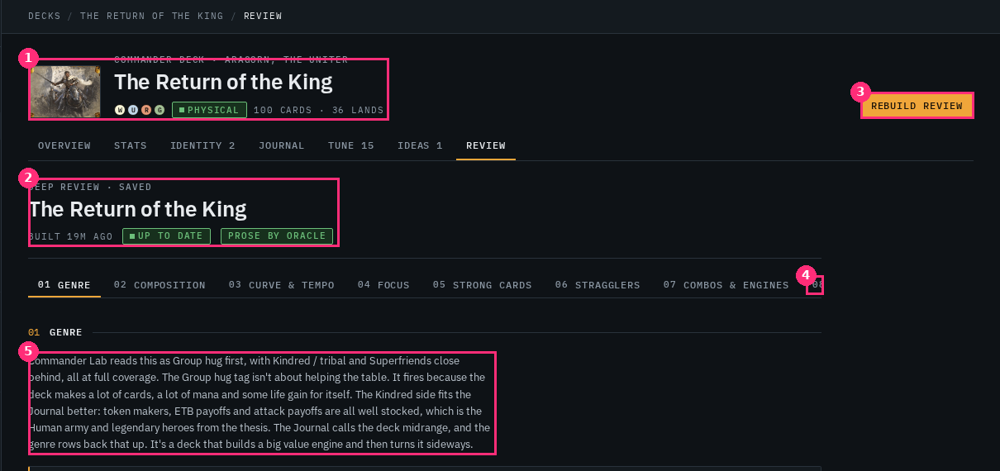
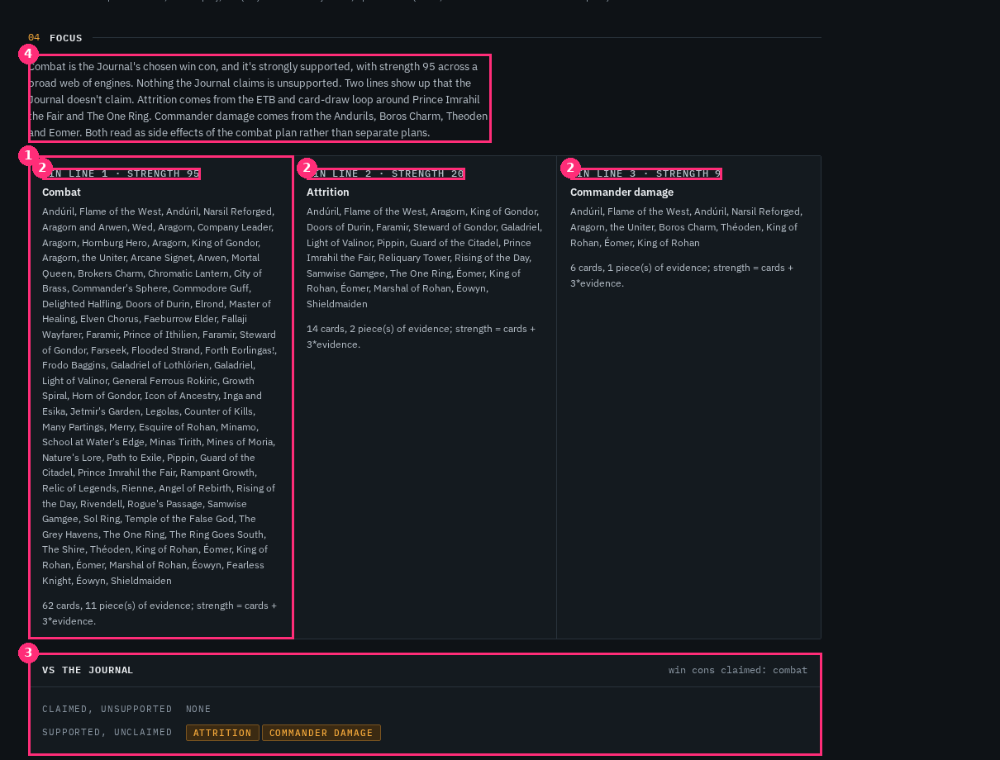
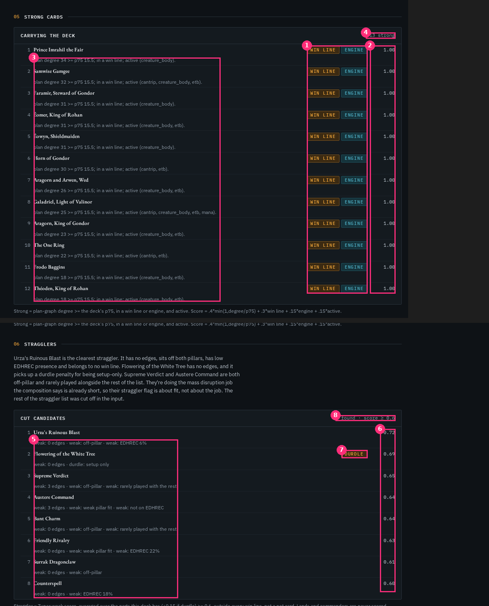
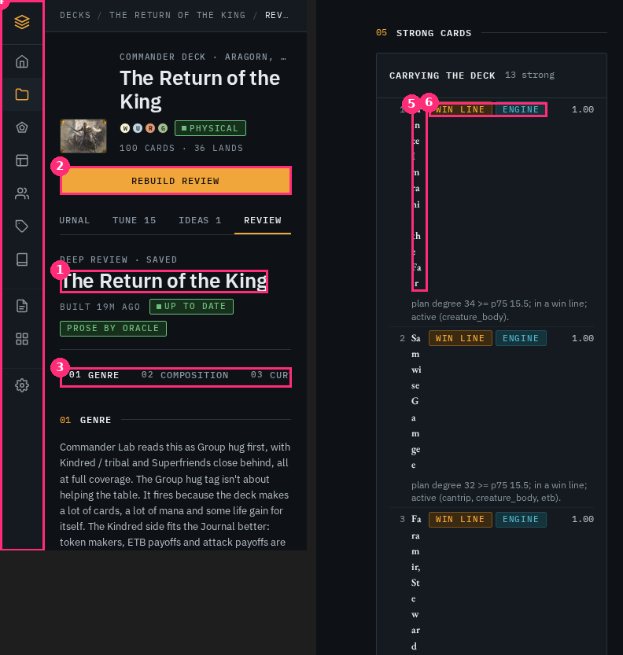
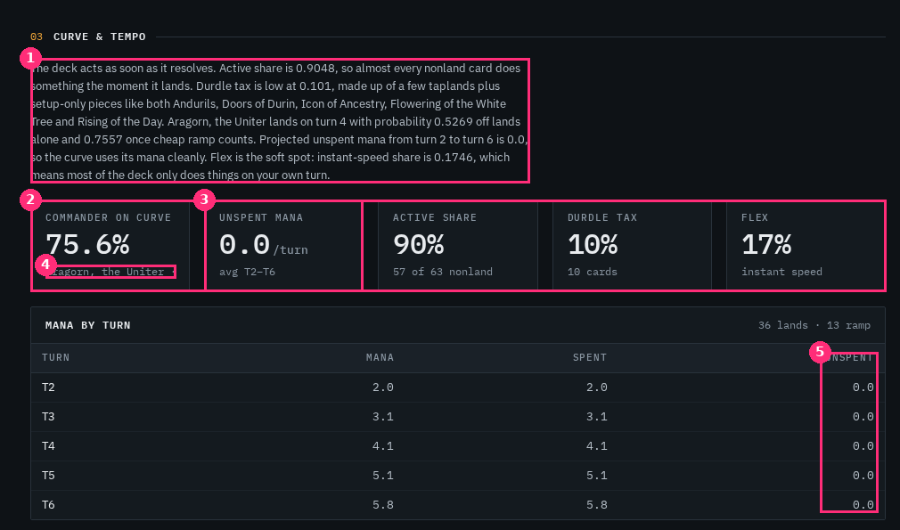
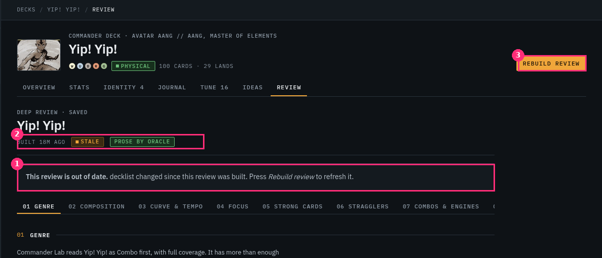
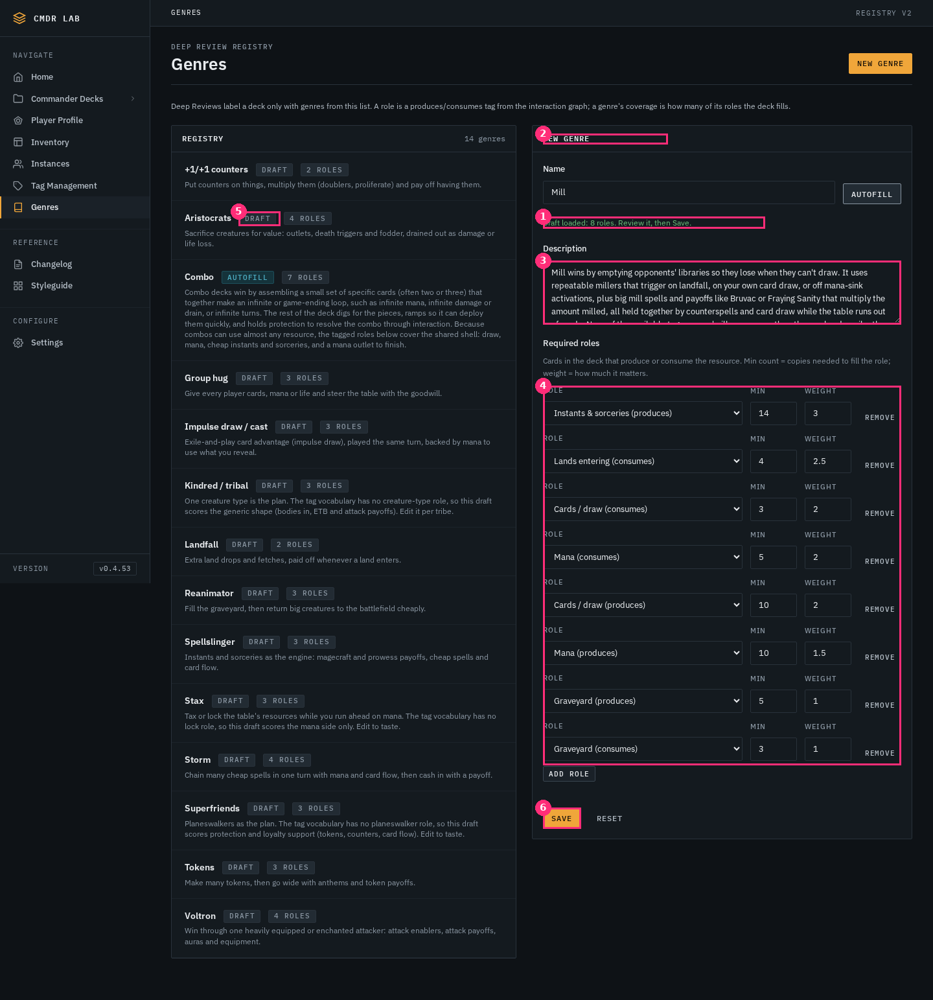
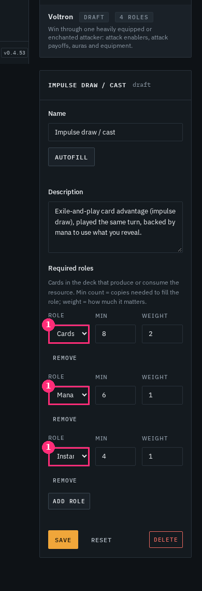
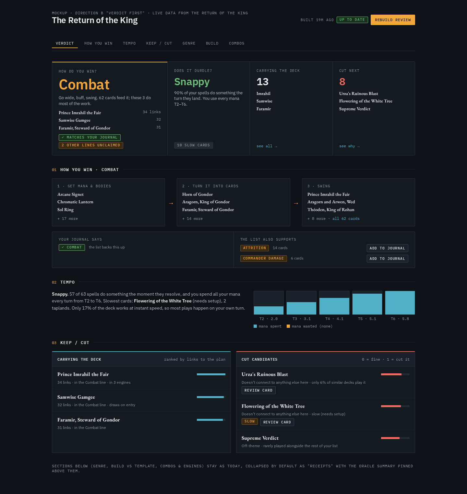
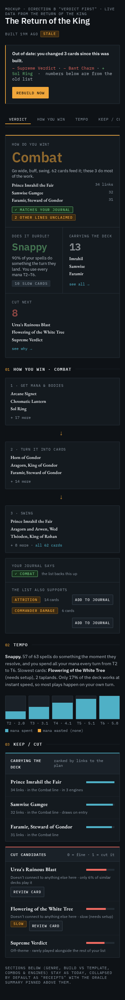

# RV-4R: Designer UX review of the live Deep Review

> **Reference only. This PR is closed unmerged; design docs never go on main.**
> Reviewed live on `http://tower:8020` (v0.4.53, includes RV-1 #114, RV-3 #116, RV-4 #117). Real pages at **1440 and 390** (headless Chromium, 390 with touch emulation), not just the code.
> Decks: *The Return of the King* (RotK, Journal claims Combat), *Yip! Yip!* (Yip, no Journal), *No The Other Frozen Throne* (empty state). Spec: `docs/REVIEW_SPEC.md`.
> Nothing was saved or rebuilt. Autofill was run on a throwaway "Mill" draft and never saved. The stale screenshot is the one RV-4 captured by editing a fingerprint (Yip), so I did not re-stale a deck.

## TL;DR

**Verdict: the numbers are solid, the page is a lab report instead of an answer.** Everything RV-4 shipped is correct, deterministic and honest (the "why" footnotes, protected pets, offline note, no horizontal overflow at 390). But the page answers "what did the math compute?" in spec order, not "how do I win, am I slow, what do I cut?" in the order Andrew asks them.

| Question from the card | Today | Grade |
|---|---|---|
| "How do you win?" instantly readable? | **No.** Focus starts 2,624px down (3,799px on phone). The win line is a comma wall of up to 62 card names. | Fail |
| Journal diff | Semantically right (red = claimed but unsupported, amber = unclaimed). Rows are tiny and hang below the card dump. | Partial |
| Stragglers vs strong clear? | **No.** Same row component, same weight, no colour. Every strong card scores `1.00` with both chips. On the phone the strong list is broken (card name 14px wide). | Fail |
| Tempo understandable without jargon? | **Partly.** "Unspent mana 0.0/turn", "Durdle tax 10%", "Flex 17%" need a manual. Prose says `0.9048` while the tile says `90%`. | Partial |
| Stale/rebuild flow | Correct but remote: banner has no button; the button is ~250px away; reload loses place; no "what changed". | Partial |
| Genre autofill/edit flow | Autofill itself is good (18s, honest dropped-tag report). The edit flow around it has silent data loss and is unusable on the phone. | Partial |

**Recommendation:** Direction **B, "Verdict first"**, shipped in 3 phases (P0 fixes now, P1 verdict band + plain-language tempo, P2 stale diff + genre editor). Direction C is the radical bet and needs one small backend change first. Full checklist at the bottom.

---

## 1. What's working (keep it)

- **Sticky section index** works, and "click → lands under the bar" is correct (Focus h2 lands at 64px).
- **No horizontal overflow at 390** on any page I checked (`scrollWidth == 390`).
- **Honest footnotes.** Every section has a "why / how computed" line. Right instinct, wrong size (see 3.4).
- **Journal diff colours carry meaning** (danger = claimed but unsupported, signal = unclaimed). Good use of the single-accent HUD rule.
- **Pet cards protected** from the cut list, with a visible reason.
- **Build job card** (queued → building → done/failed, survives navigation via localStorage) is the right pattern.
- **Autofill race guard** and the "dropped N tags not in the vocabulary" report are the right level of honesty.

## 2. The structural problem: order and length

| | 1440 | 390 |
|---|---|---|
| Page height | 7,449px | 13,983px |
| Focus ("how do you win") starts at | y = 2,624 | y = 3,799 |
| Oracle summary (the actual verdict) starts at | y = 7,186 | y = 13,619 |
| Longest section | Combos & engines, 2,178px | Combos & engines, 3,736px |
| Strong cards | 777px | **3,549px** |

The spec order (Genre → Composition → Curve → Focus → Strong → Stragglers → Combos → Summary) is a *computation* order. The summary, which is the one paragraph Andrew actually wants ("Yip does what its thesis says… the big unanswered question is the Aang/Appa loop"), is the **last thing on a 7,000px page**. And on the page, each section opens with a paragraph of prose *above* its data, so even Focus is a wall before it is a visual.

Also: deck header + doc header repeat the deck name twice, costing ~170px before any content (fig 1 ①②).

① deck header ② doc header repeats it ③ Rebuild is far from the state chips ④ index tab 08 is clipped with no scroll hint (scrollWidth 1096 in a 960 box) ⑤ prose column leaves the right third empty.

## 3. Findings, by the questions on the card

### 3.1 "How do you win?" is not instantly readable

- ① A win line is **every card that supports it**: RotK Combat lists **62** cards, Yip lists **68**. That is the whole deck. It does not say *how*. A person asks "what's the play?" and gets an index.
- ② `WIN LINE 1 · STRENGTH 95` is unit-less (95 vs 20 vs 9). The footnote on each line reads `strength = cards + 3*evidence` and "**11 piece(s) of evidence**". The reader can't tell if 95 is big. There is no bar, no relative scale.
- ③ The Journal diff is correct but is the *smallest, last* thing in the section. It is the most decision-useful element (it tells Andrew his Journal is incomplete) and it is the last block in the section, set in small mono labels.
- ④ The prose here is actually the best answer ("Combat is the Journal's chosen win con… Attrition comes from the ETB loop around Imrahil and The One Ring") and it is a grey paragraph.
- **The data to do better already exists.** Engines carry `sources → converters → payoffs` in their summaries (visible in Combos & engines). A win line could be shown as a 3-step chain with 3 named cards per step, not a list.

### 3.2 Strong vs stragglers are not distinguishable

- ① **Every strong card carries both chips** (`WIN LINE` + `ENGINE`): 12 of 12 on RotK and Yip. A chip that is always on carries zero information.
- ② **Every strong score is `1.00`.** The formula (`.4*min(1, degree/p75) + .3 win_line + .15 engine + .15 active`) saturates at 1.0 for any card that clears the threshold, so the score is a boolean wearing a number. Card #1 (34 links) and card #12 (18 links) look identical. The only real ranking signal (the plan degree) is buried in the grey note.
- ④ The header says **"13 strong"** but 12 rows render (cap at 12, not disclosed). Yip: "16 strong", 12 shown.
- ⑤ Straggler reasons read `weak: 0 edges · weak: off-pillar · weak: EDHREC 6%`: the word "weak:" is repeated per fragment, "0 edges" and "off-pillar" are internal graph vocabulary, and "EDHREC 6%" does not say 6% of what (inclusion rate).
- ⑥ Score `0.72 … 0.60` has no scale (the 0.6 threshold is only in the panel header corner, ⑧: "found · score ≥ 0.6").
- Both lists use the same `.hud-tcard` row, same typographic weight, no colour. Strong should read as *keep* (cool/data), stragglers as *act* (danger), with the cut list carrying the action ("Review card", which exists as a flow in PR #120).
- **On the phone it is broken** (fig 5 ⑤): grid is `20px 13.7px 150px 52px`. The two chips take 150px and the card name column collapses to **14px**: "Prince Imrahil the Fair" renders one character per line, 242px tall. That is why Strong cards is 3,549px on the phone.

### 3.3 Tempo ("don't durdle") is half-explained

- Jargon tiles: **Active share 90%**, **Durdle tax 10%**, **Flex 17%**, **Unspent mana 0.0 /turn**. "Durdle" is Andrew's own word so keep it as a *name*, but the tiles don't say good/bad. 0.0 unspent is the *best* possible result and reads like "nothing".
- **Number formats disagree.** Prose: "Active share is 0.9048", "probability 0.5269", "unspent … is 0.0". Tile: "90%", "75.6%". Cause: oracle sentences that quote numbers not in the metrics are stripped (see `oracle_summary.stripped_sentences`), so the model quotes raw decimals to pass validation. Fix in the validator (accept the `pct()` rendering), not in the prose.
- ① The prose paragraph sits *above* the tiles and repeats them in decimals; ③ the first tile's foot is truncated ("Aragorn, the Uniter ·", `.hud-stat-foot` is `nowrap + ellipsis`).
- ⑤ The "Mana by turn" table is 5 rows × 3 columns where Mana = Spent on every row and Unspent is `0.0` on every row. That's a table doing a bar chart's job and showing no variation.
- **There is no one-word answer.** The deterministic metrics support a label (Snappy / Steady / Durdly) with fixed, documented thresholds, which fits "numbers are app math, oracle explains".

### 3.4 Stale / rebuild flow: correct, but remote and blind

- ① The banner says *"decklist changed since this review was built. Press Rebuild review."* but has **no button**. ③ The button is top-right, ~250px away (at 390 it is above the tabs, off-screen by the time you read the banner).
- **"What changed?" is unanswerable.** A fingerprint mismatch only says *something* changed. We can compute the card diff (we hold the old and new lists): "−Supreme Verdict −Bant Charm +Sol Ring".
- ② The `STALE` chip carries the reason in a `title` tooltip, which doesn't exist on touch.
- The stale document **looks identical to a fresh one** below the banner. Old numbers are shown at full contrast with no cue they're old.
- **Saving any genre makes every deck's review stale** (`stale_reason`: "genre registry changed (vN → vM)"). The Genres page says only "Saved. Registry is now v3." Fixing a typo in one description stales every saved review (58 decks are synced). Needs either a heads-up or a smarter rule (only stale decks whose *scored genres* changed).
- Rebuild finishes with `location.reload()`: you lose scroll position, and the old review is gone with no "what's different from last time". Spec mentions a history index; nothing in the UI uses it.
- The empty state is clear and the right size (fig 9). One note: the dashed `hud.empty` box inside a signal panel inside a page is three borders for one sentence.

### 3.5 Genre autofill / edit flow

**Autofill itself: good.** 18s for "Mill"; button disabled with "Asking oracle… this can take a minute."; result "Draft loaded: 8 roles. Review it, then Save."; dropped-tag report; nothing is saved until Save.

**The flow around it:**
- **Silent data loss.** I typed a description edit, clicked another genre in the list, and the edit was replaced with no prompt (probed on the live page). Autofill output has the same exposure: one stray click discards an 18s oracle result.
- **No "unsaved" state.** Header stays "NEW GENRE", Save looks identical before and after changes. ⑤ The word **draft** means two things: the seeded registry chip `DRAFT` (not yet reviewed by Andrew) vs. "autofill draft loaded" (unsaved).
- ③ Description textarea is fixed at 4 rows; the autofill description is longer and cut mid-sentence (it includes an important honest caveat: "None of the available tags means 'mill on opponents'…").
- ④ 8 role rows × 74px = ~600px; "ROLE / MIN / WEIGHT" labels are repeated on every row. Min and Weight are unexplained numbers (a min of 14 instants?) with no preview of what they do.
- **Registry list vs genre length:** "Combo" (autofill) has a 7-line description that is 3× the height of its neighbours; list shows full descriptions.

- **Phone: tapping a genre appears to do nothing.** The editor is ~1,750px below the list; after the tap the page scrolls 88px (measured: `scrollY 88`, editor top at y=1747). The user sees nothing change.
- **Phone: role selects truncate** to "Cards", "Mana", "Instar". The meaning of a role is its *direction* ("Cards / draw **(produces)**" vs "**(consumes)**"), and that is the part that is cut off. You cannot tell what you're editing.
- Autofill button wraps under the Name field on its own row.
- Delete uses a native `confirm()`.

---

## 4. Directions

Three directions from conservative to radical. All use the existing HUD kit (`hud.css`) and tokens; no new colours.

### A. Conservative: "Fix the report" (≈ 1 coder card)
Keep the page structure. Fix what's broken and say things plainly.
- Mobile row fix, genre mobile fixes, chip/score honesty, number-format consistency, stale button inline, summary moved to the top.
- **Pros:** low risk, all frontend. **Cons:** the page is still 7,000px; "how do you win" is still a list.

### B. Middle: "Verdict first" (≈ 3 cards, **recommended**)
Mock: [`mock.html`](mock.html) with [`?state=stale`](mock.html?state=stale). Real numbers from RotK.

1. **Verdict band** at the top, one screen: *How do you win?* · *Does it durdle?* · *Carrying the deck* · *Cut next*, each a one-word/number answer + 3 card names + a link to its section. Oracle's summary pins directly below as the TL;DR.
2. **Win line as a 3-step chain** (get mana & bodies → turn it into cards → swing) with 3 named cards per step + "all 62 cards" expander, then the Journal diff as **two columns, "You said / The list also supports"** with **Add to Journal** on the unclaimed lines (the diff becomes an action).
3. **Tempo as a sentence + 5-bar strip** ("Snappy. 57 of 63 spells do something the moment they resolve…") and a deterministic label.
4. **Keep/cut as a pair:** cool-coloured meter for strong (ranked by links, not a saturated score), danger-coloured meter for cut (reasons in plain words), **Review card** on each cut candidate (reuses the flow from PR #120).
5. **Stale banner with the button inside it + the card diff**, and Verdict numbers dim to say "old".
6. Everything else (Genre, Build vs template, Combos & engines) becomes collapsed "receipts" (existing partials, unchanged).

- **Pros:** answers the four questions in the first screen at 1440 and the first ~1.5 screens at 390; reuses every existing metric; the only backend ask is small (see P2/P3).
- **Cons:** a new top band to maintain; verdict wording thresholds need Andrew's sign-off.

### C. Radical: "The playbook" (≈ 4-5 cards, after B)
Turn the review from a *report* into a **working sheet**:
- **Win-path map:** the deck's engine as a visual chain with card art thumbnails (sources → converters → payoffs), cards clickable. Hover a card: what it feeds and what feeds it.
- **Try-on genre editor:** in `/genres`, pick a deck; as you edit roles, the right side shows that deck's coverage score for the genre **live**. You see what a role/weight change does before you save it, and which decks would flip genre (also solves the "saving stales everything" problem).
- **Review diff over time:** Rebuild produces "since last review: +2 cut candidates, tempo Steady → Snappy, win line Attrition added". Uses the history index the spec already stores.
- **Review as the deck's home:** Cut next feeds straight into the single-card Review flow (PR #120) and "Keep/Cut" decisions are remembered, so the next review doesn't re-propose a card Andrew already ruled on.
- **Pros:** this is the version that makes Andrew *use* the review. **Cons:** needs ordered key-card chains from the metrics engine and a persisted "decisions" store (backend work, flag to triage); a lot of surface area.

### Recommendation
**B, phased, with C's pieces pulled in as they get cheap.** A alone fixes bugs but not the experience; C first would be building on a list that still says "62 cards". I'd ship **B P0 and P1 within a card or two**, and take the "Try-on genre editor" as the first C item because it removes the stale-everything problem at its root.

### Phased path
| Phase | Scope | Backend? |
|---|---|---|
| **P0** | Bugs and honesty: mobile strong/straggler row, `/genres` mobile (scroll to editor, full role labels), dirty-guard, chips/score/count, number formats | No |
| **P1** | Verdict band, summary to top, win chain with top-3 cards, tempo label + strip, keep/cut pair, inline stale button | Small (see checklist: top-N per win line, deterministic tempo label) |
| **P2** | Stale card-diff, "Add to Journal" from the diff, registry-staleness rule, collapse receipts | Yes (diff; genre stale rule) |
| **P3 (C)** | Win-path map, try-on genre editor, review-over-time diff | Yes (chains, history UI) |

---

## 5. Checklist for the coder card

Priority: **P0** = broken / misleading, **P1** = the redesign, **P2** = follow-on. File paths are from `origin/main` at b4ca96e.

### P0: fixes (all frontend, ship first)
- [ ] **Mobile strong/straggler/durdle rows.** At ≤ 520px `.hud-tcard` (`static/css/hud.css:1999`, `:2021`) gives the chips column (auto) 150px and the name 14px. For `.hud-tcards--panel`, move chips to their own row under the name (grid-area) so the name gets the full width. Verify 390: name never wraps per-character; Strong section ≤ ~900px.
- [ ] **Strong chips.** Show `WIN LINE` / `ENGINE` chips only where they differ from the list norm, or replace with a single "in N engines" note. Don't render an always-on chip.
- [ ] **Strong score.** Drop the `1.00` column (`partials/review/strong_cards.html`) or rank by `plan_degree` and show that. Add a meter, not a saturated number.
- [ ] **"13 strong" vs 12 rows:** say "top 12 of 13" or render all.
- [ ] **Straggler reasons.** One `weak:` prefix, plain words: "no synergies here", "off-theme", "only 6% of similar decks play it" (not "0 edges / off-pillar / EDHREC 6%"). `partials/review/stragglers.html`. Add a scale to the score ("0 fine · 1 cut") and show the threshold in the panel head without clipping.
- [ ] **Tile foot clipped** ("Aragorn, the Uniter ·"): `hud.stat` foot is `nowrap + ellipsis` (`hud.css:648`). Allow wrap for the Commander-on-curve tile.
- [ ] **Number formats in prose vs tiles.** Make the oracle validator (`analytics/review_*`, `oracle_summary.stripped_sentences`) accept `pct()`-formatted equivalents, and update the oracle prompt to quote percentages ("90%") matching the tiles. No raw `0.9048`.
- [ ] **Section index clipped** at 1440 ("08 Oracle summary" half-visible, scrollWidth 1096 / 960) and hidden on phone: add edge fade or scroll-snap affordance, or drop tab numbers.
- [ ] **`/genres` mobile: tapping a genre does nothing visible.** After `edit(id)` on ≤ 900px, `scrollIntoView({block:"start"})` the editor and move focus to Name. Add a "← Registry" link in the editor header on phone.
- [ ] **`/genres` mobile: role selects truncate** ("Cards", "Mana", "Instar"). Stack the Role select on its own full-width row above Min/Weight so "Cards / draw (produces)" is readable; keep the `title` meaning.
- [ ] **`/genres` dirty guard.** Track unsaved edits; switching genre / New / Reset when dirty asks (`hud` dialog, not native `confirm`), and an unsaved-changes pill + "Unsaved draft" in the editor header. Autofill output counts as dirty.
- [ ] **Two meanings of "draft".** Rename the registry chip to `NOT REVIEWED` (or `SEED`) and keep "Draft" for the unsaved editor state.
- [ ] **Description textarea** auto-grows (or `rows` ≥ 8 after autofill) so the caveat isn't cut mid-sentence.
- [ ] **`/genres` list:** clamp descriptions to 2 lines (`line-clamp`) so "Combo" doesn't triple its row.
- [ ] **Rebuild keeps context.** After `location.reload()` keep the scroll anchor (or hash to the section you were in).
- [ ] **Stale chip reason** visible without hover (put it in the chip row on touch, not `title`).
- [ ] Dedupe the repeated deck name (doc head `<h2>` under the deck header) → one line "Deep Review · saved · built 19m ago".

### P1: Verdict first (see `mock.html`)
- [ ] **Verdict band** (4 answers + oracle TL;DR below). Oracle summary moves above the sections; sections render as "receipts".
- [ ] **Win line chain:** top-3 cards per step, "all N cards" expander. *Backend ask:* `focus.win_lines[].key_cards` (≤ 9, ordered by plan degree, tagged source/converter/payoff). Fallback: top-3 by `plan_degree` when absent.
- [ ] **Journal diff as two columns** ("Your Journal says / The list also supports"), chips as today, plus **Add to Journal** on unclaimed lines (POST to the existing Journal win-con endpoint; confirm shape with the Journal card).
- [ ] **Tempo label** (Snappy / Steady / Durdly) computed in `review_metrics` from documented thresholds on `active_share`, `durdle_tax`, `unspent_avg_t2_t6`; **Andrew signs off on thresholds**. Sentence template from deterministic fields, oracle prose stays below it.
- [ ] **Mana-by-turn → 5-bar strip** (spent vs wasted), keep the table behind a "numbers" toggle.
- [ ] **Keep/cut pair** with distinct treatments; **Review card** button on each cut candidate (hook to the PR #120 flow when it ships; hidden until then).
- [ ] Stale banner: button **inside** the banner, one primary button on the page; dim Verdict values at 55% when stale.
- [ ] A11y/motion: `role="img"` + `aria-label` on the strip; stagger entrance 150–350ms under `prefers-reduced-motion: no-preference` only (see mock).

### P2: follow-on
- [ ] **Stale card diff** ("−Supreme Verdict −Bant Charm +Sol Ring"): compute from the previous saved fingerprint vs the current list. *Backend:* store `card_list` (names+qty) in the saved doc, or diff against the history entry.
- [ ] **Registry-staleness rule:** only mark a review stale when the *scored genres* for that deck changed (or the registry change affects its primary/secondary), not on any registry bump. Add a Genres save message: "N reviews will be marked stale".
- [ ] **Review-over-time:** "since last review" strip on Rebuild using the history index.
- [ ] Genre scoring sanity (flag to triage, **not** a UI issue): RotK's primary is *Group hug* because "a lot of cards, a lot of mana and some life gain" fires the generic tags, and Yip's primary is *Combo* at 100% coverage even though oracle's own prose notes the Journal never says so. The first thing the page shows is the least trustworthy label. Consider showing confidence ("low: 3 of 3 roles are generic tags") next to the genre.

### Hotspots
- `static/css/hud.css` (section 13 `hud-rv-*` + `.hud-tcard`) is shared with Theory/Tuner/Ideas, so row/chip fixes should be scoped with `.hud-rv-*` or `.hud-tcards--panel`, not by editing `.hud-tcard` globally.

## 6. Evidence

- Live full-page captures: `shots/live/live_review_rotk_1440_fullpage.png`, `shots/live/live_review_rotk_390_fullpage.png`.
- Annotated figures: `shots/live/fig01` … `fig09` (numbered pink callouts are referenced above).
- Mock: `mock.html` (1440 and 390, fresh and `?state=stale`), screenshots in `shots/mock_B_*.png`. The mock uses the real `static/css/hud.css` and tokens only; all numbers are RotK's saved review. The win-chain *steps* (sources/converters/payoffs) are illustrative: the card names come from the live engine summaries but the key-card selection does not exist in the data yet (P1 backend ask).
- Measured on the live page: strong grid `20px 13.7px 150px 52px` at 390; section offsets and page heights in §2; `/genres` phone `scrollY 88` vs editor `y 1747` after tap; description replaced on genre switch (dirty probe); autofill 18.2s.
