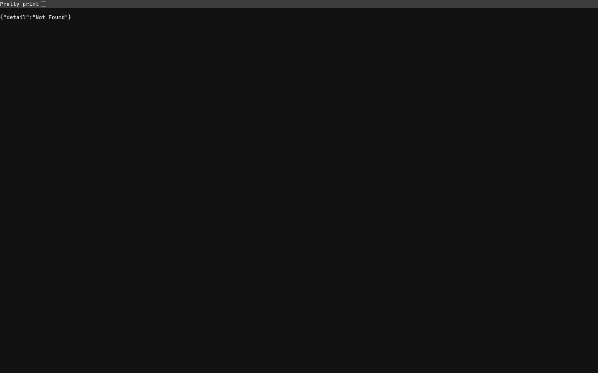
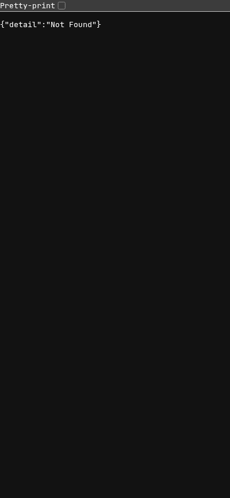

# SM-4R — live Simulate UX review

**Status: BLOCKED — production route not deployed. Not a UX approval.**

Reviewer: designer · Task: `t_1cee23ec` · Checked: 2026-10-19.
Reference: [`../UX_SPEC.md`](../UX_SPEC.md), especially §13.
Target: `http://tower:8020` (Tower LAN hostname).
Viewports: Chromium, 1440×900 and 390×844, DPR 1.
Local reference tree: `2b0b278`; this is **not** the deployed revision.

## Executive result

Both requested page types return HTTP **404**, displaying only
`{"detail":"Not Found"}` at both widths. The ordinary deck pages return
200. This is a deployment blocker, not a recurrence of the fixed JavaScript
boot bug: production never serves the Simulate HTML in the first place.

Read-only inspection of `commander-lab-app` reports:

- Compose working directory: `/data/compose/124/fbccb5df7e32ecdb1827771871b5c1c2eaf018b5`.
- Container created: `2026-10-19T04:54:56.108038157Z`.
- `/app/version.py`: release date `2026-10-15` (version starts `0.4.47`).

The current live state was checked independently; upstream test results were
not treated as evidence of the deployed UI. No production configuration,
containers, decklists, Redis values, or simulation jobs were changed.

## Verified routes and data

| Deck / endpoint | Result |
|---|---|
| `/deck/Holy%20Hellfire` | 200 |
| `/deck/Holy%20Hellfire/sim` | 404 at both widths |
| `/api/decks/417707/sim` | 200; `success: true`, `exists: true`; saved simulation exists |
| `/deck/The%20Return%20of%20the%20King` | 200 |
| `/deck/The%20Return%20of%20the%20King/sim` | 404 at both widths |
| `/api/decks/5054882/sim` | 200; `success: true`, `exists: false`, `sim: null`; confirmed empty-state candidate |

Thus the API already distinguishes saved and empty decks, but neither live
page can be reviewed. A missing page is not the designed empty state.

## B1 — deploy the merged Simulate UI before review

**Severity:** blocker for this review / high functional impact.

**Reproduce:** visit either `/sim` route above on port 8020 at 1440 or 390px.

**Expected:** Holy Hellfire displays its saved report and collapsed builder;
The Return of the King displays the open first-run builder (§4.1).

**Actual:** raw FastAPI 404 JSON, no app shell or controls.

**Required action:** authorized deployment owner deploys a main revision
containing PRs #217 and #218, then confirms these exact URLs return 200.
Use [`../../../GITOPS.md`](../../../GITOPS.md) to verify the deployed container
revision, not the sidebar's cached release badge. This review card does not
authorize an infrastructure change.

## Coverage — pending, not passed

| Requested inspection | 1440 | 390 | Reference |
|---|---|---|---|
| Standard / random / specific controls, picker keyboard flow and validation | Blocked | Blocked | §4 |
| Job progress, focus, reload resume, saved report retained | Blocked | Blocked | §5 |
| Saved header: Up to date / Stale, reason and notes | Blocked | Blocked | §6.1 |
| One-off Oracle review, notes answer and fallback | Blocked | Blocked | §6.3 |
| Static-vs-Sim curve / tempo and card panels | Blocked | Blocked | §6.4–6.5 |
| Per-game opponents, sorting, filters and mobile cards | Blocked | Blocked | §6.6, §8 |
| Empty builder, responsive fit, focus and reduced motion | Blocked | Blocked | §8–10 |

No statement about layout overflow, accessibility conformance, report quality,
or working interaction can be inferred from the 404 page screenshots.

## Upstream polish leads — not independently verified live

These are **leads for the resumed review**, not additional confirmed findings:

1. Wilson 95% confidence interval missing from the win-rate foot (§6.2).
2. Duplicate precon options disabled without the `in Seat n` explanation (§4.2).
3. Oracle prose reportedly falls back because `deck-sim-review` is not installed
   in the Oracle profile. Recheck service configuration through its owner;
   do not install into another profile as part of this design review.

Source: upstream `t_93043a42` and parent handoffs. Do not turn these into fresh
production-pass claims or count them as newly observed defects.

## Evidence

All four images are direct captures of the live target, not mockups or injected
states. [`sm4r/checks.json`](sm4r/checks.json) records Holy Hellfire viewport and
body observations.

| Page | Desktop | Phone |
|---|---|---|
| Saved-report deck | [1440](sm4r/live-404-1440.png) | [390](sm4r/live-404-390.png) |
| Confirmed empty-state deck | [1440](sm4r/empty-deck-404-1440.png) | [390](sm4r/empty-deck-404-390.png) |

## Resume / handoff gate

After deployment, repeat the entire coverage table on the actual live pages,
including genuine progress and both freshness states. Clearly label any
fixture-only state rather than passing it off as production data. Commit the
completed review and evidence, verify PR checks on its exact head, then make
the requested merge-ready handoff. This partial evidence report is not that
handoff and the review task remains blocked.
