# SM-4R: live Simulate tab UX review

Reviewer: designer · Task `t_1cee23ec` · Checked 2026-10-20, 19:50–20:15 EDT.
Spec: [`../UX_SPEC.md`](../UX_SPEC.md). Section numbers below (§) refer to it; §13 is the checklist.
Target: `http://192.168.50.3:8020`, Chromium, **1440×900** and **390×844**, DPR 1.
Raw measurements: [`sm4r/checks.json`](sm4r/checks.json). Screenshots: [`sm4r/`](sm4r/).

This replaces the 2026-10-19 partial report, which was blocked by a 404 because the deploy hadn't landed. All of
that report's untested items are re-tested below.

**Verdict: ships, needs a polish pass.** The structure, states and responsive skeleton match the spec.
The core flows work at both widths: mode switch, combobox, validation, running job and reload resume,
stale state, sort and filter, reduced motion. No horizontal overflow in any state at either width.

Four defects need fixing before this reads as finished:

- **F1:** random-mode reports render quiet-mode zeros as real data.
- **F2:** the phone game log overlaps text.
- **F3:** tempo "Below math" chips ignore metric polarity.
- **F4:** a failed run disappears silently.

The full list is in [Findings](#findings).

---

## What was reviewed

| Page | Deck | State on live | Used for |
|---|---|---|---|
| `/deck/Holy%20Hellfire/sim` | Holy Hellfire (417707) | Saved, **Specific** (3 precons), 20 games, notes, Oracle **fallback** (`ORACLE_KEY not set`) | Saved report, tray, all three modes, combobox, log |
| `/deck/Yip!%20Yip!/sim` | Yip! Yip! (17823937) | **Empty** (`exists:false`) | Empty builder, first-run flow |
| `/deck/The%20Return%20of%20the%20King/sim` | Return of the King (5054882) | Saved **Random** run from 17:38Z today, so no longer empty | Random-mode report (§6.4 "Not recorded", §13.7) |

The card's original empty-state candidate, Return of the King, picked up a random run since the last attempt.
Yip! Yip! is the empty deck instead.

**Build.** The version badge rolled 0.4.144 → 0.4.147 during the review. The two assets this tab is built from
never changed, and I hash-checked them before, during and after:

- `deck_sim.js` md5 `a3f1d542…` = the blob at `e14a16f` (#241).
- `hud.css` md5 `3a0aff66…`.

Main has since moved well past the served build:

- #250: user-defined Standard pod.
- #251: random-pool toggle.
- #253: WoWLogs-style report UI (`deck_sim_report.js`).
- #254: Focus chips replace the free-text notes field.

None of that code is what :8020 serves yet. Findings tagged **[superseded?]** touch code those PRs rewrote. The
report-section findings (F1–F3, F6, F7, F14–F18) should be re-checked against #253 after the next deploy, before
anyone opens fix cards for them.

**Evidence labels.**

- **Live**: the real page and real API data, untouched.
- **Fixture**: same live page and JS, but a fetch wrapper in *my browser only* rewrote the GET responses to reach a
  state I could not create safely: running/queued/Oracle/failed job, stale flag, populated card panels.
- Every `POST …/sim/run` was intercepted client-side and **never reached the server**.
- No simulations were started and nothing was written to production. localStorage was cleared afterwards.

---

## Coverage matrix

✅ = matches spec · ⚠️ = works, with polish items · ❌ = defect · Ev = evidence type

| Area (spec) | Deck | 1440 | 390 | Ev | Findings |
|---|---|---|---|---|---|
| Builder, empty state (§4.1) | Yip! Yip! | ✅ | ✅ | Live | F9, F11 |
| Builder, saved tray (§4.1) | HH | ⚠️ | ✅ | Live | F10 |
| Controls: **Standard** (§4.2) | HH, Yip! | ⚠️ | ⚠️ | Live | F19 |
| Controls: **Random** (§4.2) | HH, Yip! | ✅ | ✅ | Live | F5 (counts) |
| Controls: **Specific** + combobox (§4.2, §4.3) | HH, Yip! | ⚠️ | ⚠️ | Live | F5, F10, F12, F13 |
| Job progress (§5) | HH, Yip! | ⚠️ / ❌ | ⚠️ | Fixture | F4, F8, F9 |
| Report head: **Up to date** (§6.1) | HH, RotK | ⚠️ | ⚠️ | Live | F7 |
| Report head: **Stale** (§6.1) | HH | ⚠️ | ⚠️ | Fixture | F17 |
| Stat strip (§6.2) | HH, RotK | ⚠️ | ❌ | Live | F6, F1 |
| 01 One-off Oracle review (§6.3) | HH, RotK | ⚠️ | ✅ | Live | F15 |
| 02 Curve & tempo (§6.4) | HH | ❌ | ❌ | Live | F3, F14 |
| 02/03 in random mode (§6.4, §13.7) | RotK | ❌ | ❌ | Live | F1 |
| 03 Card tables (§6.5) | HH (empty), fixture rows | ✅ | ✅ | Live + Fixture | F18 |
| 04 Per-game opponent log (§6.6) | HH, RotK | ⚠️ | ❌ | Live | F2, F16 |
| Responsive / overflow (§8, §13.10) | all | ✅ | ✅ | Live + Fixture | none |
| Motion / reduced motion (§9, §13.11) | HH | ✅ | n/a | Live + Fixture | none |
| Keyboard: tab `8`, radios, focus ring (§10, §13.1) | HH | ✅ | n/a | Live | F12 |

---

## Area notes

### 1. Parameter controls (§4)

| | 1440 | 390 |
|---|---|---|
| Empty, Standard | 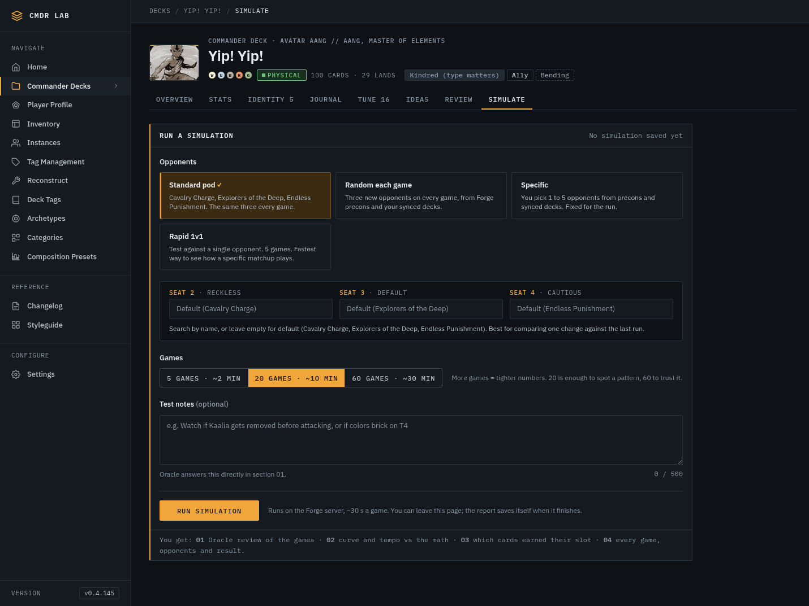 | 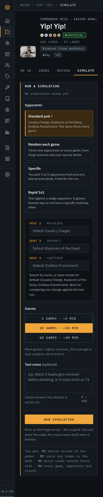 |

**Passes, both widths, both decks**

- **Empty state.** The `hud-panel--signal` builder is open, titled *Run a simulation* with meta *No simulation saved
  yet*. Standard pod and 20 games are preselected, the button reads *Run simulation*, and the 01–04 "You get" footer
  is present.
- **Saved state.** The tray is closed. The summary reads `Run new simulation · Last run: Specific · 20 games`. On open,
  mode and games are prefilled and notes are blank, as the spec asks.
- **Mode switch.** Switching mode swaps the detail block. ←/→ moves through the radio group natively. The
  `:focus-visible` ring is the amber `--focus-ring` ([tile focus](sm4r/hh-1440-tile-focus.png)).
- **Tile layout.** The selected tile has an amber fill, a 2px left bar and a `✓`. Tiles stack at ≤900; at 390 they are
  full width, the Run button is full width, and the tray summary drops to two lines.
- **Random.** The paragraph has no controls and no pod preview, and its numbers come from the pool (live: 241 = 184 +
  57). [1440](sm4r/hh-1440-tray-random.png) · [390](sm4r/hh-390-tray-random.png) · [empty 1440](sm4r/empty-1440-random.png) · [empty 390](sm4r/empty-390-random.png)
- **Specific combobox.**
  - Typing filters, with the match marked in amber.
  - No match shows *No deck matches "qqqxx".*
  - ↓/↑ wrap, Enter picks, Esc closes and keeps the previous pick, Tab moves on.
  - Group headers are sticky (*Forge precons · 184*, *Your synced decks · 57*).
  - Max height is 272px, z-index 900, and the list stays inside the viewport at 390.
  - A deck already picked for another seat is listed as disabled.
  - [filter 1440](sm4r/hh-1440-combo-filter.png) · [open, empty deck](sm4r/empty-1440-specific-open.png) · [390 open](sm4r/empty-390-combo-open.png) · [390 filter](sm4r/hh-390-combo-filter.png)
- **Validation.** Submitting with no opponent sends **no request** and shows an inline `role="alert"` with a
  `--danger` border, and focus moves to the first seat. [1440](sm4r/hh-1440-specific-invalid.png) · [390](sm4r/empty-390-specific-invalid.png)
- **Notes.** The counter turns amber at ≥450 (checked at 455).
- **Errors.** A 500 shows an inline `sm-error` ([shot](sm4r/fx-busy-error-1440.png), fixture).

**Deviations**

- Specific mode shows **5** pickers in a 3-column grid (3 + 2) where the spec has three. The 1–5 range is in the tile
  copy, so this is a reasonable extension, but the spec should say so (F10).
- There is a **fourth tile, Rapid 1v1**, which is not in the spec (F11).
- Saved tray, Specific: the seats are **not** prefilled from the last run (F10).
- Standard detail shows three editable comboboxes with "Default (…)" placeholders where the spec has a read-only seat
  list. Main (#250) replaced this with the user-defined pod, so it is **[superseded?]** (F19).

Saved-tray shots: Standard [1440](sm4r/hh-1440-tray-standard.png) · [390](sm4r/hh-390-tray-standard.png); Specific [1440](sm4r/hh-1440-tray-specific.png) · [390](sm4r/hh-390-tray-specific.png); duplicate row [1440](sm4r/hh-1440-combo-duplicate.png); Rapid [1440](sm4r/empty-1440-rapid.png).

### 2. Job progress (§5): Fixture

| | 1440 | 390 |
|---|---|---|
| Simulating, saved report below | 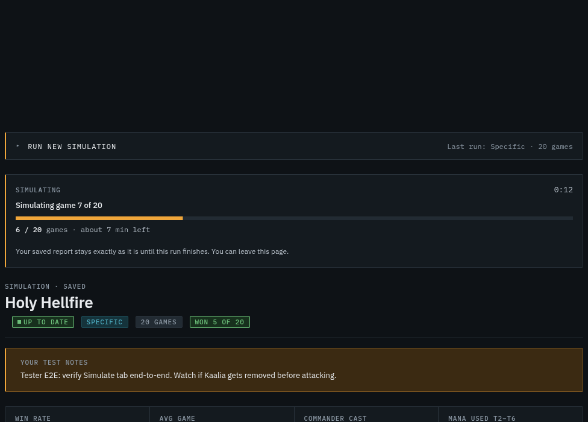 | 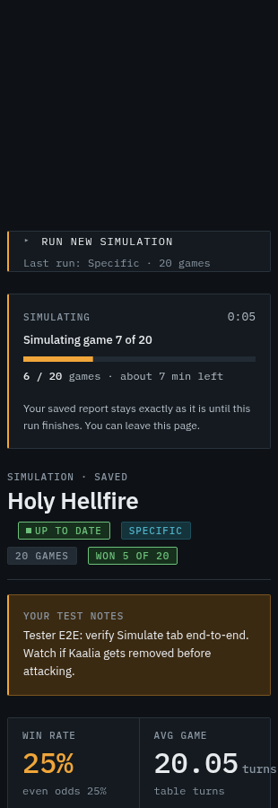 |

**Passes**

- Submit makes the intercepted `POST`, stores `simJob:archidekt:417707` in localStorage, closes the tray and disables
  the fieldsets (opacity 0.55).
- The job card appears **above the old report, which stays untouched**.
- The title reads *Simulating game 7 of 20* and the bar has `--p: 0.3` = 6/20, which is correct.
- The card has `aria-live="polite"`.
- A reload mid-run resumes the job.
- The Oracle phase is indeterminate (`job-slide`), with *All 20 games done. Oracle is reading the log.* ([shot](sm4r/fx-oracle-1440.png))
- The empty-state message reads *The report appears here when it finishes.* ([shot](sm4r/fx-empty-running-1440.png))
- The bar animates `transform` over `--dur-slow`. With reduced motion, the transition is `none`.

**Deviations:** F4 (failure path), F8 (focus, clock, ETA, queued track), F9 (Run button still live).
Queued state: [shot](sm4r/fx-queued-1440.png). Failed state: [card](sm4r/fx-failed-1440.png), [real path: card vanishes](sm4r/fx-failed-real-path-1440.png).

### 3. Saved report head: Up to date / Stale (§6.1)

| | 1440 | 390 |
|---|---|---|
| Up to date (Live) | 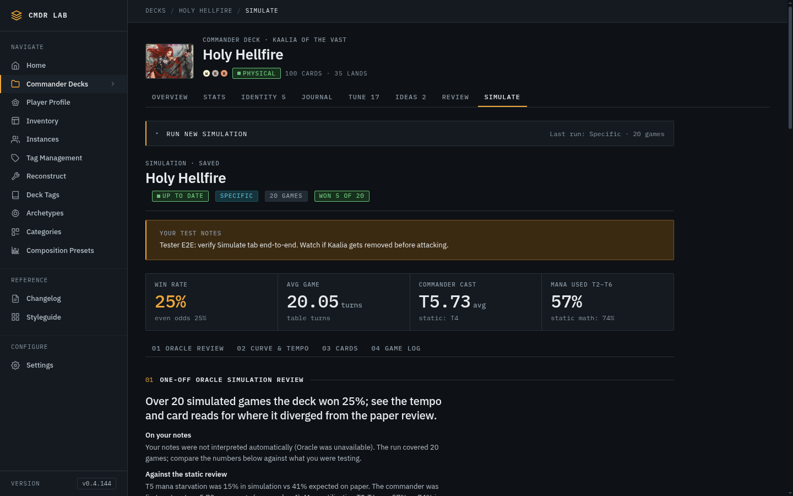 | 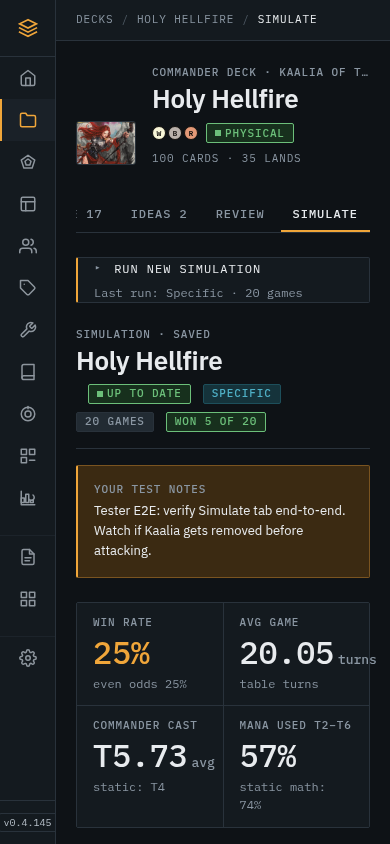 |
| Stale (Fixture) | 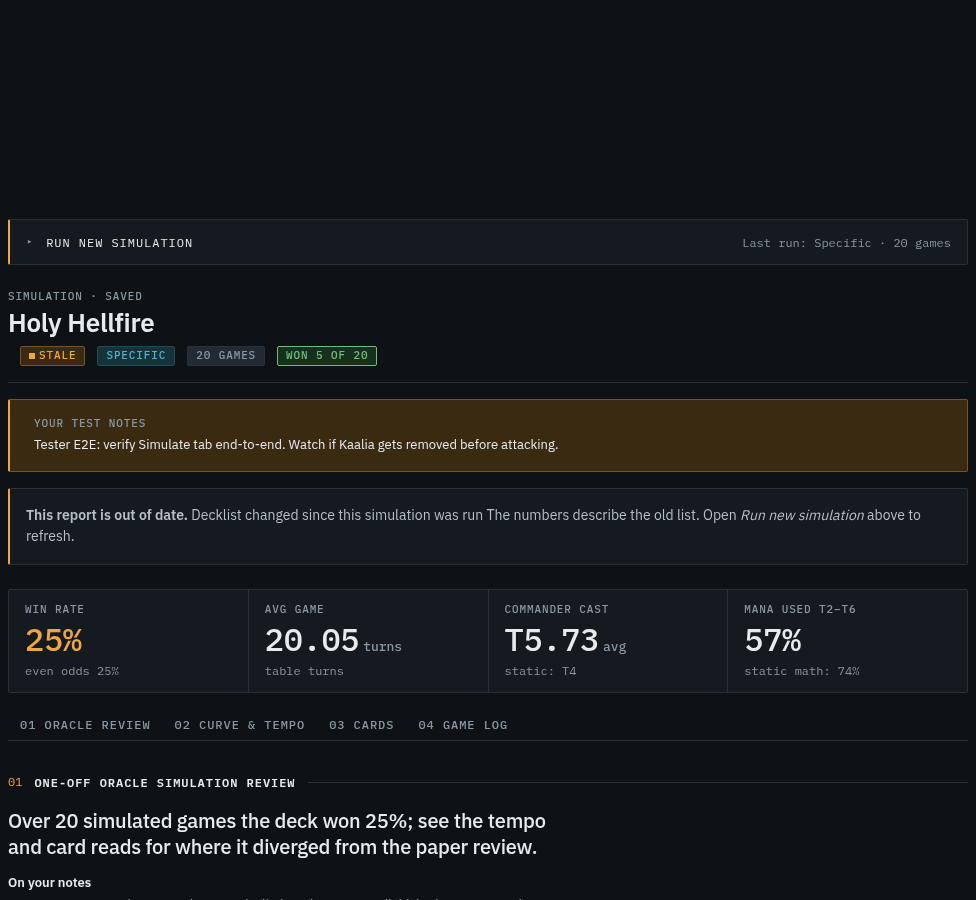 | 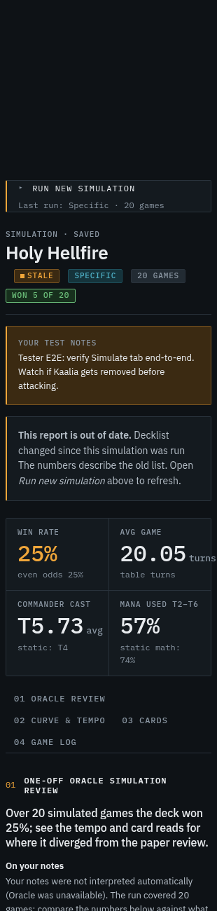 |

**Passes**

- The label reads *Simulation · saved* above the deck name.
- Chips:
  - freshness: ok/dot when up to date, signal/dot when stale, with the reason in `title`
  - mode (data tone)
  - games (neutral)
  - `Won 5 of 20` (ok tone at ≥¼)
- The notes callout shows the run's notes as typed and is omitted when a run has no notes. Its live label is
  the pre-#254 wording; main has since renamed the field *What to watch for*.
- Stale adds the `role="status"` signal note, and `#doc[data-state=stale]` is set. The report is **not** dimmed
  (opacity 1).

**Deviations:** F7 (no *Built …* time), F17 (stale copy), F6 (stat strip).
The mode chip has no `title` listing the decks in Specific mode (§6.1). This is a nit and is folded into F7.
Random-mode head: [1440](sm4r/rotk-1440-top.png) · [390](sm4r/rotk-390-top.png).

### 4. One-off Oracle review (§6.3)

[1440](sm4r/hh-1440-sm01.png) · [390](sm4r/hh-390-sm01.png)

**Passes:** the headline (`sm-headline`), the *On your notes / Against the static review / Worth trying* subheads in
spec order, and the `hud-doc-list` tweaks. The 390 layout is clean.

**Deviation (F15):** both live reports are Oracle **fallbacks**:

- HH: `source: "fallback", note: "ORACLE_KEY not set"`
- RotK: `"timed out after 600s"`

They are rendered exactly like a real Oracle read under the *One-off Oracle simulation review* header. The prose
admits it ("Oracle was unavailable"), but nothing in the layout does. This confirms upstream lead #3; the Oracle key is
an ops issue, not a design one.

### 5. Static-vs-Sim curve and card tables (§6.4, §6.5)

| | 1440 | 390 |
|---|---|---|
| 02, Specific (HH, Live) | 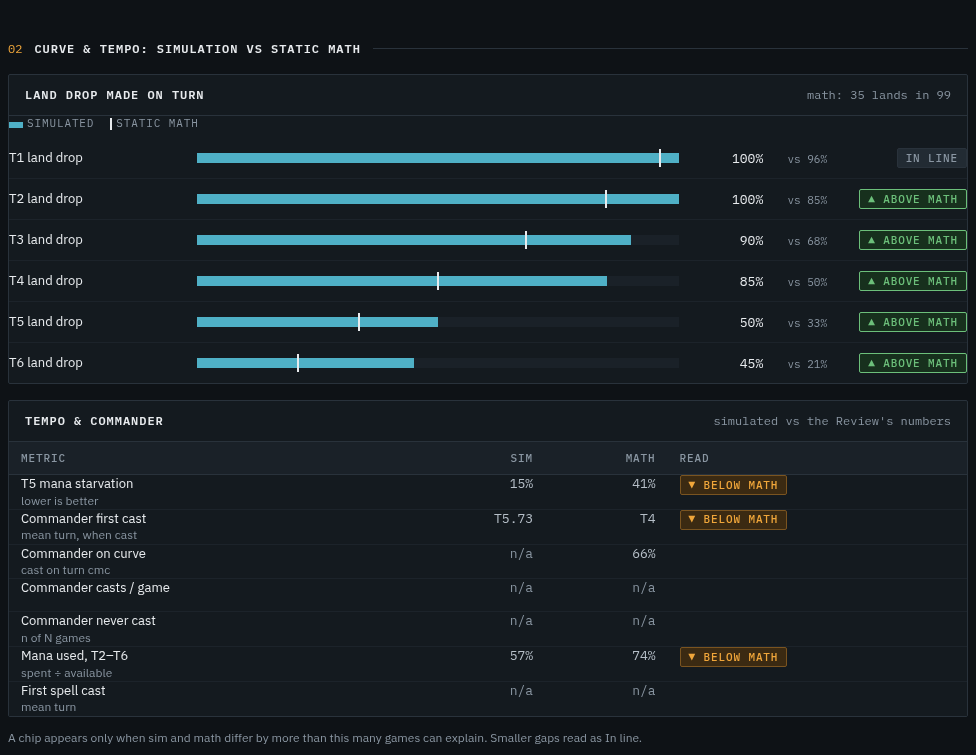 | [390](sm4r/hh-390-sm02.png) |
| 02, Random (RotK, Live) | 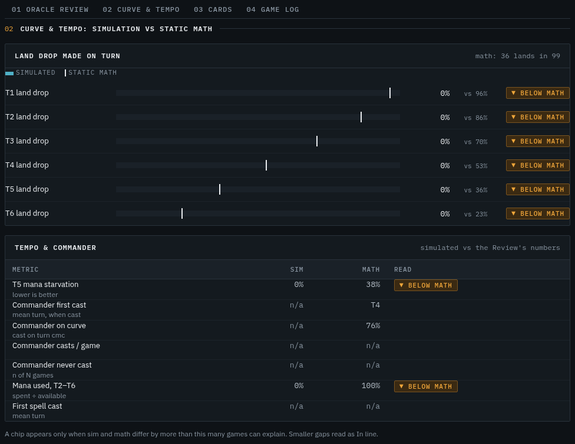 | [390](sm4r/rotk-390-sm02.png) |
| 03 cards (Fixture rows) | 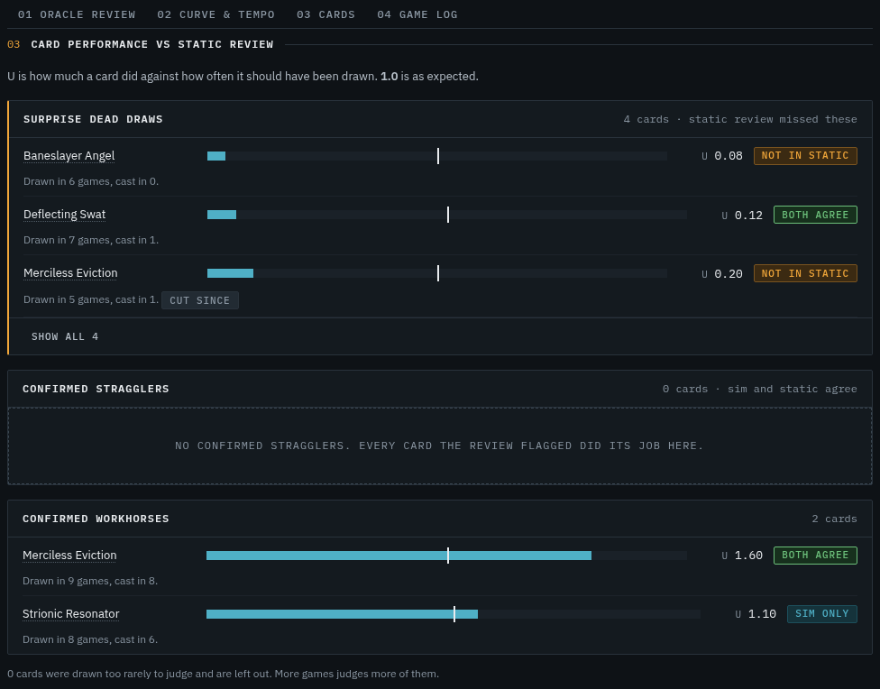 | [390](sm4r/fx-cards-390.png) |

**Section 02, passes**

- Six land-drop rows: cyan fill = sim, white tick = math. Fill and tick positions match the numbers.
- Tracks are `role="img"` with both values in the `aria-label`.
- The legend is present. The `In line` chip appears explicitly on T1.
- Phone layout follows the spec order: name, then track, then value.
- The tempo table becomes one card per metric at 390, with Sim and Math side by side.

**Section 03, passes**

- All three panels render in spec order: dead draws first, with the amber left bar.
- Live HH has zero cards in every bucket, so all three `hud-empty` empty states show and the panels stay visible.
  [live](sm4r/hh-1440-sm03.png) · [390](sm4r/hh-390-sm03.png)
- With fixture rows, using real HH card names:
  - Each row shows name, track (U/2 fill, tick at 1.0), `U 0.08` and a chip.
  - The note line and the `cut since` chip render.
  - *Show all 4* reveals the hidden row in place.
  - Card names are `hud-cp-name`, `tabindex=0`, `data-card-preview`, and hover shows the printing-specific Scryfall
    preview ([hover](sm4r/fx-cards-hover-1440.png)).

**Deviations:** F1, F3, F14, F18.

### 6. Per-game opponent table (§6.6)

| | 1440 | 390 |
|---|---|---|
| Specific (HH) | [1440](sm4r/hh-1440-sm04.png) | 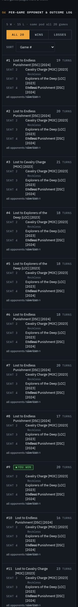 |
| Random (RotK) | [1440](sm4r/rotk-1440-sm04.png) | [390](sm4r/rotk-390-sm04.png) |

**Passes**

- The toolbar meta reads `5 W · 15 L · same pod all 20 games` (random mode: `20 different pods`).
- The `All 20 | Wins | Losses` filter hides rows: Wins shows 5, Losses 15 ([wins](sm4r/hh-1440-sm04-wins.png)).
- Headers are real `button.hud-sort`. `#` is the default order. Turns sorts descending on first click and sets
  `aria-sort`.
- Seat headers carry the AI name.
- Random mode shows a different pod on every row, which is the visual proof of per-game randomization (§13.7).
- Wins render as `■ You won` (ok). Deck names are plain text.
- At 390 the header row hides, the Sort `<select>` appears, and each game becomes a card.

**Deviations:** F2 (phone overlap), F16.

---

## Findings

Severity: **High** = wrong data or broken layout · **Med** = spec behaviour missing · **Low** = polish.
Where I could see the cause, it is named so the fix card is short. File:line refers to the **served**
`static/js/deck_sim.js` (blob at `e14a16f`).

| # | Sev | Area / § | Width | Finding | Likely cause / fix |
|---|---|---|---|---|---|
| **F1** | High | 02/03, stat strip · §0 decision 1, §6.4, §13.7 | both | **Random-mode report shows quiet-mode zeros as data.** RotK: T1–T6 land drop `0% vs 96%…` with six `▼ Below math` chips, `Mana used 0% vs 100%`, `T5 starvation 0%` (with chip), tile `Mana used 0%`. The spec rule is "never render zeros" and calls for the `sm-unrec` *Not recorded for random pods* panel, which exists in CSS but is never used. | `metricsAvailable()` tests `!= null`, so `0` passes (`deck_sim.js:243`). Key off a server `metrics_available` (§11) or `params.verbose_log === false`. The not-available copy also says "legacy run" instead of the §6.4 text. |
| **F2** | High | 04 · §8 (≤640) | 390 | **Phone game-log cards overlap.** Every `td` keeps `.hud-table td { height: var(--row-h) }` = 32px inside the card grid. Seat cells need 35–53px, so the AI/set line draws over the next seat and "Cautious" sits on top of "all opponents have lost". Visible on every card in both decks. | Add `height: auto` to `.sm-log td` (and `.sm-tempo td`, 34 vs 32px) in the 640 block. |
| **F3** | High | 02 Tempo table · §6.4 Read | both | **Chips ignore polarity and fire on every row with two numbers.** `T5 starvation 15% vs 41%` (lower is better) shows amber `▼ Below math`. `Commander first cast T5.73 vs T4` shows `Below math` (should be *Later than math*). There is no in-line or better state, so the colour now carries no meaning. | `showChip = sim != null && math != null` with the read hardcoded to `"worse"` (`deck_sim.js:310–323`). Use the server's `read` / `read_label` (§11), or compute the direction per metric. Same for land-drop rows: the read comes from a client-side ±0.08 delta, not a "can't be explained by N games" threshold. |
| **F4** | High | Job, failed · §4.1, §5 | both | **The real failure path is silent.** With a job id in localStorage and the poll returning `failed`, the code `forget()`s, reloads, and the card disappears: no message, tray closed, inputs gone. The failed card only appears when GET returns `running_job.status=failed`. When it does appear, the left bar is amber, not `--danger`; the copy still says "stays… until this run finishes"; and the tray doesn't reopen. | Keep the failed job in state through `load()`; render it with `--danger`, failure copy, re-open the tray with the submitted params, and show the error under the notes. |
| F5 | Med | Combobox · §4.2 | both | **The pool leaks raw ids** into *Forge precons*: `sample_mind_seize`, `sample_power_hungry`, `user_24011416`, `user_417707` (Holy Hellfire's **own** id, in its own list), `user_5054882`. Precon rows show **no `SET YEAR`** on the right because set and year stay inside the name. A duplicate precon shows a **blank** right label instead of `in Seat 2`: upstream lead confirmed. | Leak: backend `opponent_pool` (flag to SM-3 owner). Labels: strip `[SET] [YEAR]` into `set`/`year` (§11 note). In `comboRows` (`:103`) the precon branch wins before the `disabled` check, so swap the order. |
| F6 | Med | Stat strip · §6.2 | both / 390 | **Win-rate foot has no Wilson CI**: it reads `even odds 25%`, but the API has `summary.win_rate_ci95 = [0.11, 0.47]` (upstream lead confirmed). Avg game shows `20.05` unrounded (spec `18.4`) and lacks `fastest N`. Commander foot lacks `85% cast it`. **At 390, `turns` overflows the tile by 8px.** | Read `report.summary` (not only `pod_breakdown`), round to 1 dp, and let the unit wrap or shrink at ≤640. |
| F7 | Med | Report head · §6.1 | both | **No *Built 27h ago*.** The `<time>` renders empty, with an empty `title`. The empty flex child also pushes the first chip 12px right of the heading's edge (visible in every head shot). | `reportHead` gets `res.sim.meta`, which carries `saved_at`, not `created_at`; `res.meta.created_at` exists. Pass that, and fill `title` with the absolute time. Also add the deck names as the Specific mode chip's `title`. |
| F8 | Med | Job · §5, §10 | both | Focus stays on `BODY` after submit; the card has `tabindex=-1` but is never focused. The clock counts from page load (reload shows `0:04` for a job created 3:31 earlier). The ETA is a 30 s constant from game 0; the spec says the mean of finished games, shown after game 2. Queued has a static empty track, not `job-slide`. | Focus `#job` on start; base the clock on `created_at`; compute the ETA from `(updated_at − created_at) / games_completed`; add `data-phase="queued"` → indeterminate. |
| F9 | Med | Builder, run active · §4.1 | both | **Run button and notes stay enabled during a run** because they sit outside the disabled fieldsets. Empty state is worst: the full open panel stays live under the job card ([shot](sm4r/fx-empty-running-1440.png)). A second submit hits 409 and is followed, so the risk is low. | Spec: "form hidden while disabled". Wrap the whole form in the disabled fieldset, or hide the run bar. |
| F10 | Med | Specific · §4.1, §4.2 | both | The saved tray after a **Specific** run opens with all five seats empty instead of the last pod (`params.opponents`). Five seats in a 3-col grid leave a ragged 3 + 2 row, and AI labels repeat R/D/C/R/C. The validation copy is group-level ("Pick at least 1 opponent.") on Seat 2, which is fine for 1–5 but differs from §4.3. | Prefill `STATE.picks` from `params.opponents`. Update the spec to 1–5 seats (designer follow-up) or lay out 5 across at ≥1181. |
| F11 | Low | Mode tiles · §4.2 | 1440 | The **Rapid 1v1** tile is not in the spec, and the 3-col grid orphans it on its own row ([shot](sm4r/hh-1440-tray-standard.png)). Picking it forces 5 games but leaves 20/60 clickable. | Product call: 4-up row (preferred) or 2×2. Lock games while Rapid is selected. Spec needs an entry. |
| F12 | Low | A11y · §4.2, §10 | both | Detail blocks have no `aria-live="polite"`. Options have no `id`s and the input has no `aria-activedescendant`, so screen readers don't follow ↓/↑. *Show all* removes its own button, so focus drops to `BODY`. | Add the attributes; move focus to the first revealed row. |
| F13 | Low | Notes · §4.2 | both | ⌘/Ctrl+Enter doesn't submit (no listener). | Add a `keydown` listener on `#notes`. |
| F14 | Low | 02 panels · §6.4 | both | Land-drop panel body padding is **0**: `.hud-panel--flush > .hud-panel-body` beats `.sm-cmp`, so the legend, labels and chips touch the border. **At 390 the read chips are hidden** by the global `.hud-comp-row .hud-chip { display:none }` @640 (spec: chip on row 1). Panel meta lacks `20 games ·`. The footnote says "this many games" (spec `{N}`). The hint `n of N games` is literal. | Raise `.sm-cmp` specificity; override the chip rule inside `.sm-cmp`; interpolate N. |
| F15 | Low | 01 Oracle · §6.3 | both | A fallback review looks like a real Oracle read (see area 4). | When `oracle_review.source === "fallback"`, add a neutral `Oracle unavailable` chip by the header and keep the computed prose. **Ops:** HH has `ORACLE_KEY not set`; RotK timed out. |
| F16 | Low | 04 log · §6.6 | both | The filter doesn't update or announce the meta ("Showing 5 of 20 games"); the meta has no `aria-live`. Loss cells lack the `Seat n` line. Seat sub-lines repeat the AI instead of `SET YEAR` (names keep `[MOC] [2023]`), which causes the 3-line wraps. A null `win_reason` renders an empty cell (HH #20); use `—`. **The phone Sort `<select>` has no `change` handler** and does nothing. | Wire the select to the same sorter; split set/year (same as F5). |
| F17 | Low | Stale note · §6.1 | both | The copy is missing a full stop: "…since this simulation was run **The** numbers…". The reason is generic ("Decklist changed…") where the spec wants `n cards swapped (+A, −C)`. `cut since` chips couldn't be verified live (no stale report). | Add `". "`; ask SM-3 for a swap summary. |
| F18 | Low | 03 cards · §6.5 | both | The footnote reads "0 cards were drawn too rarely…" from `unmatched_cards.length`, not `unjudged_n`/`deck_size`, so it's wrong-looking on every live report. Note lines lack the static score. | Use the spec fields, or omit the line when unknown. |
| F19 | Low | Standard · §4.2 | both | Live Standard detail = three editable pickers with "Default (Cavalry Charge)" placeholders and a hardcoded pod. **[superseded?]** Main #250 replaced this with a user-defined pod and updated §4.2. | Re-review after deploy. |

Upstream leads from the previous attempt, now **verified live**: the Wilson CI is missing (F6), the duplicate-precon
`in Seat n` label is blank (F5), and Oracle is falling back (F15).

### Deliberately not flagged

- **The `Up to date` chip during a run.** Correct per §5: the old report stays exactly as it is.
- **Tall phone log (20 cards ≈ 4,000px).** Accepted by §6.6 (no pagination).
- **The 56px rail at 390.** This is app shell, outside this tab's scope.

---

## Evidence index

All in [`sm4r/`](sm4r/). `fx-*` files are fixture-driven states; everything else is a direct live capture.

| Group | Files |
|---|---|
| Holy Hellfire, 1440 | `hh-1440-top`, `-sm01`…`-sm04`, `-sm04-wins`, `-tray-standard/-random/-specific`, `-combo-filter`, `-combo-duplicate`, `-specific-invalid`, `-tile-focus` |
| Holy Hellfire, 390 | `hh-390-top`, `-sm01`…`-sm04`, `-tray-standard/-random/-specific`, `-combo-filter` |
| Empty (Yip! Yip!) | `empty-1440-standard/-random/-specific-open/-rapid`, `empty-390-standard/-random/-specific-invalid/-combo-open` |
| Random report (RotK) | `rotk-1440-top/-sm02/-sm04`, `rotk-390-top/-sm02/-sm04` |
| Fixture states | `fx-running-1440/-390`, `fx-queued-1440`, `fx-oracle-1440`, `fx-failed-1440`, `fx-failed-real-path-1440`, `fx-empty-running-1440`, `fx-stale-1440/-390`, `fx-cards-1440/-390`, `fx-cards-hover-1440`, `fx-busy-error-1440` |
